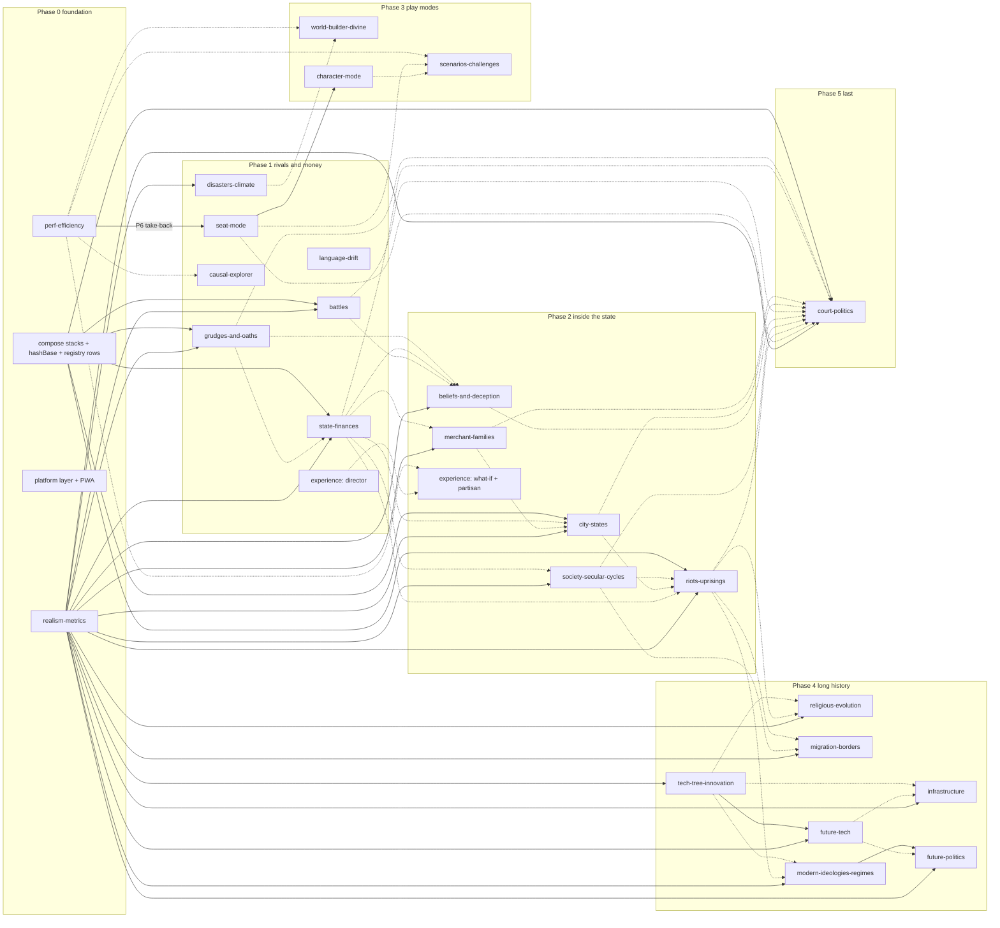

# worldseed master plan (integration review of the 24 plans; base `main` @ 8cabf09)

This file sits above the 24 plans. It points into them as `plan §x`. It does not restate their designs. Where it rules
on a conflict, the ruling is also written back as a short `## Addendum (master plan)` at the end of each affected plan.
Precedence, highest first:
1. this file's rulings (§2) and registry (§3);
2. plan addenda (the newest first);
3. plan bodies.

Tags: **[M]** measured in a plan, **[A]** a plan's estimate or design default, **[G]** a guess of mine, **[R]** a
ruling made here. Speculation is marked where it appears.

Coverage note. Every plan was read in its interface, contract, rules, determinism, steps, performance, risk and addendum
sections, and in the rule sections that touch shared draws. Long phrase tables, prose examples and reference lists were
skimmed, not read line by line. A conflict hidden in those parts would not be caught here.

---

## 1. Vision and architecture

### 1.1 The system after every plan lands (one page)
- **Same core.** A deterministic world (`generateWorld`), then a year-stepped history in a worker (`createRunner`). The
  output is a struct-of-arrays `History` that the main thread stages and renders.
- **Every plan is an overlay.** Each one is behind a `HistoryOptions` switch, has its own RNG stream, and leaves the base
  bit-identical when off. The off test is §2.1.1 R2.
- **Inputs = the URL = the save recipe:**
  - seed, world edits (world-builder-divine §2);
  - options (one flag per plan, §3.3), orders (nudges, seat cards, person orders, divine acts), cradles, deposits,
    scheduled shocks;
  - the seat (seat-mode §3.4).
  - The recipe is world-builder-divine §4.1. Nothing else changes a run.
- **Five layers of simulated systems:**
  1. **Physical:**
     - world-gen, with tectonics (disasters §2.1) and builder edits;
     - weather and climate (disasters);
     - population and food;
     - networks (infrastructure).
  2. **Economic:**
     - goods and merchants (repo), with merchant families as share overlays;
     - the treasury, credit and money (state-finances);
     - wages, rents and elites (society).
  3. **Political:**
     - polities, war and bonds (repo);
     - grudges, oaths, balance and arms (grudges);
     - beliefs and bargaining (beliefs);
     - battles;
     - forms of government (city-states → modern-ideologies → future-politics, one `Government` field);
     - the court inside monarchies (court-politics);
     - unrest from grievance up to revolution (riots);
     - migration and borders.
  4. **Cultural and technical:**
     - ideas: the tech tree, pressures and literacy (tech-tree), plus future rows (future-tech);
     - religion, with doctrine and secularity (religious-evolution);
     - language (language-drift: assembly-only, cosmetic).
  5. **Player and presentation:**
     - seat, character and divine modes;
     - scenarios, the daily challenge and prediction;
     - the world builder and saves;
     - the director, what-if and partisan sagas (experience);
     - the why-explorer (causal).
- **Coupling is only through named O(1) hooks** owned by one plan (§1.4). Every shared draw is modulated through one
  **composition stack** (§2.3) with a fixed order and a global clamp. This keeps 24 overlays from silently multiplying
  the same probability.
- **Presentation reads History only.** Director, what-if, causal, sagas and scenarios goals are DOM-free and run in Node
  for harnesses. The sim stays DOM-free in the worker (portable to WASM or native later, §1.2).

### 1.2 Platform target
Owner context, given by the coordinator. The recommendation awaits the owner's confirmation (D-P1, §6.2).
- **Targets:** Mac, iPad and later iPhone.
  - Stay web. Phase 0 makes worldseed an **installable PWA**:
    - a manifest, `display: standalone`;
    - a service worker with an offline cache of the app shell and models;
    - `navigator.storage.persist()` on the first explicit save (world-builder-divine §4.3 already plans that call).
  - Later, a **thin native shell**: one SwiftUI multiplatform Xcode project wrapping `WKWebView`. It brings:
    - App Store distribution;
    - iCloud saves (recipes are small JSON, world-builder-divine §4.5);
    - Files import and export;
    - Game Center leaderboards (this would replace scenarios §3.12's no-backend leaderboard problem);
    - haptics.
  - No native rewrite unless real-device profiling shows the budgets of §5 cannot be met.
- **Memory is the binding constraint and wrapping does not lift it** [coordinator-supplied; not re-verified here]:
  - `WKWebView` content runs in a separate WebContent process.
  - The increased-memory-limit entitlement applies only to the app process (Apple developer forums).
  - Caveat: WebKit bug 274637 is titled ["Add entitlement to give the WebProcess a higher jetsam limit"](https://bugs.webkit.org/show_bug.cgi?id=274637).
    Whether it shipped, and for whom, is not verified. Plan as if the WebContent limit is fixed until a device test
    shows otherwise.
  - So **the iPhone WebContent budget gates every plan**, with or without a wrapper.
- **Storage:** home-screen web apps keep their own day counter for Safari's 7-day eviction [coordinator-supplied:
  WebKit blog posts 10218 and 11338; world-builder-divine §4.3 cites Wilander 2020 for the same]. The PWA install is
  therefore also the durability fix for saves.
- **Constraints on every phase [R]:**
  1. **Platform layer in Phase 0:** `src/platform/` with `storage` (IndexedDB, guarded localStorage, persist), `files`
     (export, import, share sheet), `haptics` (no-op on the web) and `env` (device class, standalone).
     world-builder-divine's `SaveStore` (§4.3) and scenarios' attempts (scenarios step 9) plug into it.
  2. **The sim stays DOM-free in the worker.** No plan may import DOM, CSS or `window` into `src/sim/**`. There is a lint
     test.
  3. **Touch-first, small-screen-first.** Every new panel and card is designed at 360×640 first, with 44-pt targets
     (experience §8 already cites Apple's HIG). The desktop is a widening.
  4. **Device-class budgets are hard gates (§5.3).** Device classes: D-desk (Mac and desktop), D-tab (iPad), D-phone
     (iPhone).
  5. **Determinism outranks device.** A sim option must never default differently per device, because links and saves
     must reproduce. Phone limits act only on UI, worker policy (checkpoints, compare tier, bake) and the default
     extension length (§5.4).

### 1.3 Dependency graph (plans; solid = needs it, dotted = optional with a proxy)

Two edges deviate from README's literal build order:
- battles, disasters and language run in Phase 1 lanes in parallel with grudges → finances, instead of after city-states;
- the director lands in Phase 0.

Neither has a hard dependency on the chain (battles §0, disasters §0, language §9.3, experience §5 "Director
(independent)"). This needs the owner's OK: D-B1 (§6.2).

### 1.4 Shared quantities: one owner (single writer) each

| quantity | owner (writer) | API (pure, O(1), neutral when the owner is off) | readers | notes |
|---|---|---|---|---|
| treasury, revenue R/R°, need, pay ratio `pPay`, tax pressure `taxMul`, rate `r_p`, price level, wage lag | state-finances §0.3, §0.3b | `finTreasury, finRevenue, finNeed, finSpend, finCredit, finPrice, finWageLag, finFundYears` | city-states, society, riots, beliefs, court, MIR, FP, infra, migration, disasters, seat, character | rate multipliers come from the C9 stack (§2.3) |
| fiscal distress SFD | state-finances §2.8 | `finSFD` | society (Ψ), court, MIR, FP | society's proxy only when finances is off (society §0.2) |
| grievances g(p,q), faithless f, δ, threat θ, arms `M_p` | grudges §3.5, §3.6a, §3.10, §3.11 | `recordGrievance, g, standingGrudges, threatOf, oathDelta` | beliefs, migration (prestige), court, experience (stance), causal, infra, FP | others write rows only through `recordGrievance`; arms enters `adv`, not the C1 mul (grudges §3.11) |
| foreign beliefs (estimate, precision), `intelEdge` | beliefs §3.1–3.3 | `beliefAt, intelEdge, beliefDefector, beliefPlant` | battles, experience, seat fog, court, character, infra (Wire channel) | domestic perception is riots', not beliefs' (riots §0.8) |
| discontent D (`ps.unrest`), legitimacy L, cruelty, tyranny memory, perceived and true discontent, movements and adherents | riots §4.2, §4.6, §4.8, §0.8 | `upPerceived, upTrue, up.L, upCommune, revoltAt, tyrannyAct` | court, MIR, FP, migration, religious (adds to L∞ via hook), seat | religious `faithLegitimacy` and FP `lBase/lPerf` add to L∞ through riots' L∞ hook only |
| Ψ = MMP·EMP·SFD, elite share ε and overproduction o, wages, coercion κ, scarcity, disorder, secular phase | society §0.4, §2.5 | `psi, mmp, emp, sfd, socWage, socElite, socOverprod, socCoercion, socScarcity, socDisorder, socRevoltMul` | riots, city-states, court, MIR, FP, migration, FT | **Ψ enters the revolt hazard exactly once** (riots §0.2) |
| per-polity member aggregates (pop, foodBase, town pop, wealth, mw, faith mix) | society [R] (new `polity/aggregates.ts`, D-dup 9) | `polAgg(s, p)` | court, MIR, FP, migration, society | one O(living) pass per `POLITY.step`, not five |
| government form `G.form` and its log | city-states §3.3 (`setForm` is the only writer) | `govAt`, `setForm(..., silent)` | everyone; MIR and FP write through `setForm` | Government 7–29 rows come from MIR and FP registries (§3.2) |
| regime (sub-form of Monarchy and Signoria), offices, factions, policy vector, estates and privileges | court §0.2, §3, §6.4 | `C.regime, courtPolicy, courtPlotHeat` | MIR, migration, infra, FP | court hooks act only for Monarchy/Signoria (court §0.2; R11 below) |
| ModernRegime (sub-form of Government 0 and 7–29), franchise f, contestation c, ideology shares | MIR §0.2 (FP adds rows only) | `ideoRegime, ideoFamily, ideoShare, ideoFranchise, ideoContest` | FP, migration, religious | `History.modernRegimes` extends the governments log (D-dup 2) |
| literacy, openness O, era, Bass intensity, industrial index, pressures z, bans, levers (yield, fisc, credit, toll, famine, army, unlock) | tech-tree §0.2, §0.3 | `ideaLiteracy, ideaOpenness, ideaEra, ideaIntensity, ideaIndustrial, ideaUnlock, ideaInfraMul, …` | everyone; FT adds rows, levers and channels | proxy without tech-tree: one shared `litProxy` (D-dup 8) |
| displacement u, automation, AI level and alignment, anthropogenic T and veil, off-world rows, collapse cap, longevity | future-tech §2.5 | `futDisplaced, futAutomation, futAlign, futLife, futReach` | society, riots, FP, migration, infra, disasters (T into its ClimateSeries) | — |
| fertility slot F (demographic transition) | future-tech §2.5.3 until demography.md exists [R] | `fertMul(s, id)` (C5) | religious (`faithFertility` composes in), migration | demography.md is dangling (§2.9) |
| natural shocks, climate series, struck towns | disasters §2.2–2.4 | `disasterShockAt, strikeTown, dx.struckYear/Loss` | riots, migration, religious, FP, infra, world-builder-divine (scheduled shocks, own stream) | shocks are a function of (seed, world) only |
| network cost, cell multiplier, electricity, water, wire, held share, march length | infrastructure §0.2 | `infraNetCost, infraCellMul, infraElec, infraWater, infraWire, infraHeld, infraMarchLen` | trade, migration, beliefs, riots, disease, polities, FT (prices modes; infrastructure builds) | owns all networks, including air, rocket and gate (_CONVENTIONS ownership line) |
| migrant stocks (heritage), border policy, nativism N, coalition C, **welfare regime** | migration §0.3, §3.12, §3.15 | `migHeritage, migPolicy, migNativism, migWelfare, migGenerosity` | riots, court, MIR, FP, language-drift | standing welfare is migration's (D-dup 6) |
| **prestige Π** (soft power) | migration §3.6 [R] (culture-soft-power is not written) | `migPrestige(s, mg, a, p)`; polity-level `prestigeOf(s, p)` = Π_p (new alias) | religious (`faithPull`), FP, experience | §2.9 |
| doctrine axes, secularity, tolerance, usury, faith legitimacy | religious §0.4 | `doctrineOf, secularAt, faithTolerance, usuryRate, faithLegitimacy, faithOpennessTerm` | tech-tree, finances (C9), migration, riots, court, city-states | — |
| battle casualties, commanders, fame, war tempo parameters | battles §3.2, §3.9, §3.12 | `battleCoup, battleNewCommander, battleRecall, intel via beliefs` | court, character, city-states, causal | battles is the tie-break owner of `war.alpha` and `war.durCv` (realism §6) |
| divine favour, devotion, doubt | world-builder-divine §3.2–3.4 | `History.divine` | seat, scenarios | court's royal "favour" is renamed `courtFavour` to avoid confusion (court §6.7) [R] |
| merchant capital shares (families) | merchant-families §2.1 (the pool `mw` stays goods') | `familyLendCapacity, familiesAt, topFamilies` | finances, city-states, society (naming), infra, riots, migration | — |
| order kinds and the `ORDER_KINDS` table | seat-mode §3.6 (table owner) | `ORDER_KINDS` rows 0–83 (§3.2) | all plans adding kinds | Phase 0 adds all rows as reserved placeholders (R40) |
| drama score S0 | experience §2.2 | `registerDrama, S0` | causal, scenarios (finder) | coverage test over the live `EventType` |
| why records | causal §3 | `History.why`, `whyRivalry`, `whyUnrest` | UI | recorder lines go next to every term (causal §0.3) |
| engine hash and recipe | world-builder-divine §4.1 [R] | `__WORLDSEED_ENGINE__`, `SaveRecipe` | scenarios (`v=`), cache key, P6 checkpoint key | D-dup 7 |

---

## 2. Reconciliation (the core rulings)

### 2.1 Cross-cutting rulings that change the exit criteria

**R2. What "off = bit-identical" means.**
- The golden hashes in perf-efficiency §1.1 (seed 1 `923881e7cd3fe59b`, 42 `3bac8db3dfd723b5`, 1234
  `2bb9f72e9e99433d`) are `hashValue(history)` over the **whole** History. `hashValue` hashes typed arrays by
  constructor name and bytes, and objects by sorted keys [V `src/historyCache.ts:390`].
- So every plan that adds a History field, even an empty one, changes that hash with its feature off. HANDOFF's PR rule
  ("keep the golden hashes with its feature off") is unsatisfiable as written.
- Ruling:
  - Phase 0 adds `hashBase(h)`: `hashValue` over a projection of h onto the 8cabf09 History key set.
    - Nested records (`Wars`, `Bonds`, …) are projected onto their 8cabf09 fields.
    - Fields that a plan widened are projected back to their 8cabf09 type. For `IdeaAdoptions.idea`, Uint16 → Uint8 is
      exact while every id is < 256.
    - Events are kept as they are: with features off, no new event exists.
  - **G0** = `hashBase` at 2000 years for seeds 1, 42 and 1234 with every new option false. On 8cabf09, hashBase equals
    hashValue by construction, so G0 is the three hashes above, frozen for the whole programme.
  - **G1** = `hashValue` with the current defaults. It is re-recorded in the PR that flips a default, with the note the
    plans already prescribe ("with X false the tree was checked identical on every 8cabf09 field").
  - The plans' own `hashBaseFields`-style filters (rulers.test.ts:25, battles §4, disasters §4) stay as unit tests.
    hashBase is the programme gate.

**R3. Idea-id widening.**
- _CONVENTIONS made tech-tree's step 1 widen `IdeaAdoptions.idea` to Uint16, but tech-tree §8 step 1 does not list it,
  and tech-tree §0.4 still says future-tech should do it.
- Ruling: tech-tree step 1 does it, with the R2 projection and a cache version bump. future-tech §0.3.9 and §5 step 1
  already assume this.

**R40. Contiguous `ORDER_KINDS`.**
- `ORDER_KINDS` is array-indexed (seat-mode §3.6), but plans land out of numeric order: court (33–38) lands last while
  tech-tree (39–40) lands in Phase 4.
- Ruling: the Phase 0 scaffolding commit adds rows 10–83 as reserved placeholders (`check` returns `SystemOff`, no
  encode key). Each plan replaces its own rows. The `DecisionKind` table 0–54 is treated the same way.
- This is hash-neutral: the table is not in History.

**R42. No device-dependent sim defaults** (§1.2 constraint 5).

### 2.2 Contradictions between plans, with rulings

| # | conflict (plan §) | ruling [R] |
|---|---|---|
| R1 | Phone sim speed: seat-mode §9/§11 "3–5× desktop" vs perf §3 P6 "1.5–3×". Both unsourced; both are relative to the same 2-vCPU VM figures (≈3 ms/y). | §2.6. |
| R4 | `export const SeatKind` is defined twice: merchant-families §2.7 `{Home, Branch}` and seat-mode §3.4 `{People, Polity, House, Family, Person}`. This is a compile error in one contract.ts. | Families' enum is renamed **`FamilySeatKind`** (also `FamilySeatOpen` and `FamilySeatClose` for symmetry). seat-mode keeps `SeatKind`. |
| R4b | EventType name **`RegimeChanged`** appears twice: court 292 and MIR 310. A duplicate key in the `EventType` literal. | Court keeps `RegimeChanged: 292`. MIR's 310 becomes **`ModernRegimeChanged`**. |
| R4c | EventType name **`Concession`** appears twice: riots 282 and infrastructure 354. | riots keeps `Concession: 282`. infrastructure's 354 becomes **`ConcessionGranted`**. |
| R5 | `Pov.kind`: FP §0.5 and §11.4 add `'movement'`; MIR §0.5 and §6.5 say the same thing is `'ideology'`. | `'ideology'` only. Kinds: `'people', 'state', 'faction'` (court), `'ideology'` (MIR and FP), `'person'` (character). |
| R6 | Shortcut keys: battles §7.2 wants `B` (taken: Library); its addendum suggests `W`; experience §1.8 takes `W` (what-if) and `H` (director). Free today (README): not `Space, 1–4, arrows, Home, End, V, L, M, C, U, Y, O, A, B, S, J, Esc, ?`. | `W` what-if, `H` director, **`R` battle replay**. All keys go through world-builder-divine's `ui/shortcuts.ts addShortcut` with a duplicate-key test. Builder `Space`+drag orbit is scoped to builder mode. |
| R8 | grudges §5 (rev 2) targets top-realm share p90 **−5 to −20%**. realism §0 and §4 say the largest state's share is already low (0.15–0.16 median against 30–37% peaks), and the band [0.15, 0.40] fails on half the seeds. Coalitions that level empires would move a failing metric the wrong way. | grudges' target becomes: realms with top share > 0.45 at a slow step are reduced by ≥ 5%, and `pol.largestPop1500/2000` may not be flagged WORSE. Coalition decades ≥ 65% stays. |
| R9 | scenarios' ensemble (§0, step 3) re-draws `'history-weather'` only. With disasters on, regional harvests come from `'history-climate'` (disasters §2.2), and weather's crisis is drawn but not applied. The ensemble would then perturb almost nothing. | `HistoryOptions.ensemble` re-seeds both `'history-weather'` and `'history-climate'` from `from`. The natural shock schedule (`'history-shocks-*'`, `'history-volcanoes'`) stays world-fixed and is disclosed as unresampled luck, next to rulers' pre-drawn deaths (scenarios open question 3). |
| R10 | Two paths to a burghers' rising when riots is on: city-states §4.4 makes its own draw (× (1 + socUrban) × (1 + communeRise·upCommune)), and riots §0.4/§4.10 escalates Commune-program insurrections into `govRisingResolve`. The same town can rise twice. | With `s.up !== null`, the city-states rising draw is **kept** (G.rng stays aligned) but no longer resolves anything. A hit adds a Commune trigger `λ += UP.communeSpark (0.5)` at the town (riots §4.4 triggers). Resolution is only through riots → `govRisingResolve`. The charter branch is unchanged. Both plans, and court's estates rising (court §4.4), share one `rose[i] = year` gate: one rising per town per year. |
| R11 | Signoria gets both city-states `GOV` (unrest 1.15, reach 0.8, contest 0.05) and court `REGIME` (Patrimonial or Sultanistic: grief, reach, contest, overthrow). court §0.2 says the two never hit the same hook, but for Signoria they do. | When `s.court !== null`, court's REGIME values replace GOV's on every key both define, for Monarchy and Signoria. GOV's Monarchy column is already neutral on those keys. With court off, GOV applies. |
| R12 | MIR §4 `REGIME_MODS` lists `war`, `grief`, `tax` and `tariff` columns that GOV columns 7–11 (MIR §7.1) also carry. Its CM column (overthrow 0.4) duplicates court's Constitutional (0.4). | MIR applies `REGIME_MODS` only for `rate, repress, concede, overthrow, export, bloc, climate, pairPeace` (as its §7.1 last line says), and never the CM column, which is court's. The other cells are documentation. |
| R13 | future-tech §2.5.4: "Without society: polity unrest += FUT.uUnrest·u_p". This bypasses riots' term table. | u_p is always a grievance term (`terms[13]`, RevoltCause 17 Displaced) through the C2 stack, with or without society. |
| R14 | MIR §0.1 says FP's Government values start at 16 and GovernmentCause at 30. FP §0.1 and _CONVENTIONS say 12–29 and 23–41. | _CONVENTIONS and FP win. MIR's note is stale. |
| R15 | Prestige: migration §3.6 defines Π. religious §0.3/§0.5 waits for culture-soft-power's `prestigeOf`. infrastructure has a regime "prestige lines" factor. | migration owns Π. It adds `prestigeOf(s, p) = Π_p`, which religious reads. infrastructure's "prestige lines" is a build-priority factor only, not a quantity. |
| R16 | The demographic transition: _CONVENTIONS gives it to demography.md (not written). future-tech §2.5.3 says it is "required, or the run explodes". religious §4.1 wants a fertility slot. | future-tech §2.5.3 owns the slot `F_p` until demography exists. religious `faithFertility` multiplies into it (C5). **Consequence:** religious fertility is dormant unless future (or demography) is on. That is stated in religious' addendum. |
| R20 | Four relief channels: riots `relief` (grain dole), disasters Phase 2 relief (§3.8), migration welfare regimes (§3.12), future-tech UBI and welfare relief (§2.5.4). migration already says the dole cost is not booked twice. | migration's welfare regime is the standing policy. riots' `relief` is the emergency flag, set to 1 under PoorRelief or later. disasters' relief calls riots' GrainDole concession when riots is on (its own spend otherwise). future-tech relief composes into migration's generosity `g = 1 − (1 − g_mig)(1 − r_FT)`. All costs go through `finSpend(..., 'welfare')` once. |
| R23 | battles §9.1 body: GeneralTurned = 8, and a proposed `Massacre = 9` grievance (9 is beliefs' SpyCaught). | GeneralTurned = 11 (battles addendum). A slaughter grievance, if grudges wants one, takes the next free value (17). |
| R25 | character §6/§10 and step 14 offer a `CityFocus` walkable-city hook. The owner dropped the walkable city (HANDOFF). | Dropped from character step 14. |
| R26 | world-builder-divine §0.1: "No new ReignEnd: future-politics already holds 12–13". | MIR holds 12–13 and FP 14–15 (§3.2). The decision (no new value) stands. |
| R27 | future-tech §0.2 says "no other plan adds StructureTypes", gives OrderKind "next free 41+", and §2.5.9 has "IdeaHow.Recovered (14)". | infrastructure adds StructureType 12–20. future-tech's orders take the next free value at build time (§3.2). Recovered = 15. |
| R28 | migration §0.1: Nativist = "5 if MIR adds none". | MIR adds 5 Ideology, so **Nativist = 6**. |
| R29 | Default flips: plans flip `X.enabled = true` in their last step and re-record goldens. Several flips in one PR would hide which one moved the realism score. | One default flip per PR, with the realism A/B and G1 re-recorded (§8). |
| R31 | grudges step 9 and perf §4 end with `git format-patch` and bundles to `/home/claude/...` paths. | Obsolete. Use the branch-per-step-group PR workflow (§8). |
| R32 | language-drift on "only for new worlds" (owner decision) has no carrier: a URL without a flag must keep old names. | New option `HistoryOptions.language`, URL `lang=1`. New links and saves get `lang=1` explicitly; a missing flag means off. It is part of the save recipe's `options` (world-builder-divine §4.1) and scenarios' canonical JSON (scenarios §3.1). |
| R33 | Seat Placate and Purge, divine Portent, Bless and Curse, and character's coup lever multiply the overthrow draw; Purge sets it to 0. With the C3 clamp, a player order could be clamped away. | Order factors are applied **after** the global clamp (C3, C7). Player intent is not clamped; Purge = 0 stays a hard veto. |
| R36 | causal UnrestPart pre-allocates parts only up to court's Estates (21); `UNREST_PARTS` = 24. future-tech Displaced, FP Generations, the disasters grievance and society's two peasant sub-terms have no part. | UnrestPart 22 Displaced, 23 Generations, 24 Disaster, 25 Immiseration (society h2 wage), 26 Coercion (society h2 κ); `UNREST_PARTS` = 32. RivalryPart 10 TradeRival (city-states), 11 Bloc (MIR), 12 Reputation (grudges `repRivalry`). |
| R37 | experience's addendum lists the event blocks to register only up to 289. | The coverage test reads the live EventType anyway. The registration list is §3.1 (all blocks through 419). |
| R38 | city-states §3.2 claims 200–209 and uses 200–205; _CONVENTIONS says 200–205. | Block 200–209 is city-states'. 206–209 are its spares. |

### 2.3 Double counting: one composition rule per shared draw or quantity
Shared rule for every stack [R]:
- A stack is one function in `src/sim/history/compose.ts`. It is created as a pass-through in Phase 0 and is G0-neutral.
- Factors are applied in a fixed order (fixed float order, deterministic). An absent system contributes no factor: it
  is **skipped, not ×1**.
- The non-order factors' product is clamped to [lo, hi]. Player-order factors (seat, character, divine) are applied
  after the clamp (R33).
- **Neutrality:** when no contributing system is on, the function returns the 8cabf09 expression verbatim. That is
  G0-tested.
- Each stack has a semantic owner. The owner sets the order and the clamp. Other plans register a factor in one line,
  plus a causal recorder line (causal §0.3).
- Clamps are [A] design defaults. Each owner's harness reports the share of draws at the clamp; the target is ≤ 1%.

**C1. War declaration** (`war.ts declarations`). Semantic owner: grudges.
- The drive term is today's `rv·sm(adv)·crisis·(1−E)`:
  - arms multiplies `adv` (grudges §3.11);
  - with beliefs on, `adv` → â plus the preventive max-term, and the drive is a "press", not a declaration
    (beliefs §3.4).
- Multiplier stack, in order:
  1. ruler: `rulerWar`, or court's winning-faction `war(q)`, which replaces it, never both (court §6.4);
  2. form: `GOV.war·(1 + GOV.tradeWar·compete)` (city-states §4.11, with MIR §7.1 and FP §7.1 columns);
  3. grudge: `1 + OATH.drive·g(p,q)` (grudges §3.5);
  4. money: `finWarDrive` (finances §2.4.6);
  5. dyad: MIR `pairPeace` × future-tech `deterMul` (MIR §4, FT §2.5.6);
  6. ideology: `1 + IDEO.intervene·relR` (MIR §4.6).
- Clamp [0.1, 5]. beliefs' `pressMul` is a calibration constant outside the clamp.
- Not in this stack:
  - the holy-war drive keeps its own path (religion `holyDrive` × `GOV.holy` × religious Martial × FP Theocracy 1.2,
    composed inside `holyDrive`);
  - truce, bond and maxWars are gates, not factors.
- Test: declarations per 100 polity-years within ±20% of baseline with all Phase 1–2 systems on (grudges §5,
  beliefs §9.1).

**C2. Revolt** (`unrest.ts`). Semantic owner: riots. Until riots lands, society owns the h1 multiplier (society §0.5).
1. **D (discontent) is additive.** One `CAUSE_OF_TERM` table (riots §4.2) extended by R13 and R36:
   - terms 0–4 base;
   - 5 Taxes (finances; riots fills it when finances is off);
   - 6 Urban (society);
   - 7–12 riots;
   - **13 Displaced** (future-tech) → RevoltCause 17;
   - **14 Generations** (FP) → RevoltCause 18;
   - the disasters grievance adds to term 0 (Peasant), with its own UnrestPart 24.
   - migration's nativism enters only as a movement (term 12, Ideology). religious tolerance acts on MinorityAttacked
     and the Persecution push, not on D.
2. **One form multiplier on the grievance sum:**
   - GOV.unrest (city-states, MIR and FP columns), or court REGIME.grief for Monarchy/Signoria with court on (R11);
   - never MIR REGIME_MODS.grief (R12).
3. **Hazard:**
   - riots on: `μ = λ0·D²·socRevoltMul + triggers` (riots §4.4);
   - riots off: `U.chance·m(Ψ)` (society h1).
   - socRevoltMul is the **only** multiplicative hazard term (Ψ once). Every other influence must be a grievance term or
     a trigger.
4. **Separate actors with their own draws:**
   - city-states' burghers (R10: a trigger once riots is on);
   - court estates (court §4.4).
   - They share the `rose[i]` gate.
5. **Outcome strength:**
   - rebels: society h2b `eliteLead`, riots participation;
   - suppression: `projAt` (with `pPay`) × Λ × crisis;
   - court office factors.
6. Clamps: D ≤ 1; μ ≤ 0.5 a year per town.
- Test: revolts per polity-century within ±30% of baseline, and no cause above 50% of revolutions (riots §8 target),
  with all Phase 2 systems on.

**C3. Ruler overthrow** (`rulerYear` x). Semantic owner: state-finances (first lander).
- The `overthrowHazard` extraction (seat-mode step 6) moves to the Phase 0 scaffolding.
- Factors, in order:
  1. `finOverthrow` (finances §2.4.6);
  2. society h5 EMP (society §2.7);
  3. battles coup (battles §3.6);
  4. the form's overthrow: court `REGIME.overthrow·(1 + plotHeat)` for Monarchy/Signoria, or MIR `REGIME_MODS.overthrow`
     (Government 7–11; FP's via `mods`), exclusive by Government;
  5. riots' fear after NoblesExecuted (×0.5).
- Clamp [0.2, 4].
- Then order factors: seat Placate ×0.35 / Purge = 0; divine Portent ×0.8 / ×1.3, Bless ×0.7, Curse ×1.4; character
  general `1 + I`.
- Court coups are a separate attempt path under court's total-overthrow guard (court §6.5).
- Test: Overthrown + Revolution + Murdered ≤ 25% of reign ends on every seed (riots and court targets).

**C4. Empire reach λ** (`control.ts pReach`). Semantic owner: infrastructure.
- Factors, in order:
  1. form: GOV.reach, or court REGIME.reach (R11);
  2. court Chancellor `0.97 + 0.03c` (court §5.4);
  3. network: future-tech's single `1 + FUT.reachK·(futReach − 1)`, with `√L_p` replaced by `(1 + reachRail·infraHeld)`
     when infrastructure is on (infrastructure §0.4); or, without future-tech, infrastructure's
     `1 + reachRail·held + reachWire·wired`.
- battles adds nothing.
- Clamp [0.5, 3].
- Test: `lifeE.ended/n ≥ 0.5` at 2000 years (realism §5), and `pol.largestLand ≤ 0.40` at 4000 and 6000 years [G band].

**C5. Population growth** (`population.ts`). Semantic owner: future-tech §2.5.3 until demography.md exists (R16).
1. **Harvest h:**
   - weather, or disasters' climate (FT's anthropogenic T added inside disasters' ClimateSeries);
   - × divine Feed (floor 1), Bounty (×1.15) and Storm (×0.8), order factors capped at the system's max harvest
     (world-builder-divine §3.3);
   - then storage (disasters §3.8 damp).
2. **Supply:**
   - base × `ideaFarm` (tech-tree `yield`, future-tech yield rows: one lever, tech-tree §2.3) × `(1 − disorder·D)`
     (society h7);
   - plus future-tech's land-free urban food and arcology cap.
3. **Growth:** `g·F_p·faithFertility`, where the product F·faith ∈ [0.15, 1.3].
4. **Shortfall deaths:** `× migRelief × ideaFamine`, product ∈ [0.3, 1].
- Test:
  - world population at 2000 years within −10%/+25% of baseline with tech-tree on (tech-tree §11.1);
  - future-on: the population peak 2–5× the pre-industrial plateau and a stop within ~400 y of `pill`
    (future-tech §2.5.3).

**C6. War end (peace) hazard.** Semantic owner: battles (tempo, battles §3.12).
- Factors, in order:
  1. `peaceChance` (battles tempo values);
  2. `× (1 + peaceDebt·…)` (finances §2.4.6);
  3. court faction tired-peace factor (court §6.4);
  4. `+ decisivePeace` (additive, battles).
- Per-year cap 0.6.
- WarBankrupt (finances) ends wars directly (mutiny) and is not a factor.
- Test: `war.durCv ∈ [0.7, 1.4]` and a mean duration of 6–12 y, measured after each of grudges, finances and battles
  in build order. battles tunes last (realism §6 tie-break).

**C7. Alliance chance** (`bonds.ts`). Semantic owner: grudges (balance).
- Factors, in order:
  1. `ALLIANCE.chance` with balance's θ ramp and coalition bonus (grudges §3.10);
  2. `÷ (1 + repAlliance·f)` (grudges §3.6);
  3. MIR `1 + AFF` (MIR §4.7);
  4. court Chancellor `0.8 + 0.2c` and the faction policy (court §5.4, §6.4).
- Clamp [0.1, 4]. Then the order factor: seat Ally ×4.
- Test: alliances formed within −20%/+40% of baseline (grudges §5 rev 2).

**C8. Tax take** (wealth tax `w`). Semantic owner: state-finances.
- Factors, in order:
  1. pressure: finances `taxMul·assessR`, or riots `TAXMUL[taxLvl]` when finances is off (riots §0.3), exclusive;
  2. form: court `courtTaxEff` (REGIME.tax × Treasurer) for Monarchy/Signoria, or MIR `tax` for Government 7–11,
     exclusive;
  3. capacity: tech-tree `ideaFisc` (with future-tech's fisc rows).
- Clamp [0.3, 3].
- Test: no polity with taxMul at taxMax for more than 50 consecutive years in more than 10% of polity-years.

**C9. Borrowing rate multiplier** (`rateMul_p`). Semantic owner: state-finances.
- Factors: `govRate` (city-states `setRateMul`) · `courtRate` · `ideoRate` · `fpRate` · `usuryRate` (religious §4.2) ·
  `ideaCredit` (tech-tree).
- Clamp [0.5, 2].
- These plans already write it as a product (court §0.4(b), MIR §0.5, FP §0.5). This stack fixes the order and the clamp.

**C10. Movement spread β.** Semantic owner: riots §4.8.
- Factors: β_k (the ideology row, MIR) × `(1 + 0.5·a(newspaper))` (tech-tree §0.5) × regime `climate` (MIR §4) × FP
  surveillance (FP §6.4).
- Clamp [0.2, 3].
- infrastructure's `wireW` is a Hawkes kernel weight inside riots' normalisation, not a β factor. The branching bound
  holds (infrastructure §0.4).

### 2.4 Feedback loops that can run away or oscillate

| # | loop (plans) | damping already planned | added [R] | test (harness; on seeds 1, 7, 42, 1234 unless said) |
|---|---|---|---|---|
| F1 | debt → tax pressure → Taxes revolts → lost revenue and suppression cost → debt (finances §2.4.7, riots, society SFD) | taxMul ≤ taxMax; default haircut resets debt; stain; riots relief and concessions | C8 clamp; C2 has Ψ only once (SFD inside Ψ, Taxes as a term, so it is not counted twice) | taxMul-at-max share (C8); Taxes revolts per polity-century ≤ 2× the mean of the bottom SFD tercile |
| F2 | arms race → war → grievance → arms race (grudges §3.11, §3.5) | Euler stability `k² < a²` and the monotone map (grudges §3.4); demobilisation ×0.5; grievance half-life 30 y; fatigue × finNeed; race hysteresis | none | `armsCapYears` = 0; ≥ 40% of races end Eased; ≤ 3 wars per pair per century |
| F3 | bankruptcy → short wars → reserves → declaration drive → more wars (finances §8) | chestMul, afterDefault | C1 clamp | war count within ±20% (C1 test) |
| F4 | prestige → immigration → wealth and cities → prestige (migration §3.6, §3.8) | wages fall with L (society); room tests; nativism closes borders; inertia | Π uses wealth per head (not totals) | Gibrat β ≤ 0.03; primacy ≤ 4; heritage share in the top-Π polity ≤ 0.5 |
| F5 | innovation → population → Scale pressure → innovation (tech-tree §3.2, §11.1) | caps; future-tech transition; Henrich losses | C5 clamps | C5 tests; era-0–4 first-years within tech-tree §6.1 bands |
| F6 | ideology waves → revolutions → exported programs → Subversion grievances → wars → crises → waves (MIR §4.6, riots, grudges) | Hawkes subcritical n0 ≤ 0.6 (proof in riots §4.4); at most one revolution per polity per year; Thermidor route; SIS recovery | export pulses only when `export·a ≥ 0.3` | regime changes per polity-century ≤ 1.5 (median); no single ideology above 60% of world adherents for more than 300 y at 3000 years |
| F7 | contagion: riots Hawkes + infrastructure wire kernel; disease over air and rail edges (infrastructure §0.4; FT pandemics) | the normalisation keeps the branching bound; FT's collapse cap | the wire kernel inside the normalisation | `diag.branch < 1`; n0 = 0.95 terminates (riots); pandemic GreatCollapse ≤ the cap |
| F8 | elite overproduction ↔ instability (society §2.4): an **intended** oscillation | thinning; `memDamp` refractory period | none | secular-cycle period 150–250 y (society's own target); amplitude bounded: Ψ p90 < 6 |
| F9 | coup cascade: overthrow → low legitimacy (Usurped L0 0.4) → Usurpation grievance → revolution → new low-L ruler (riots §4.6) | L habituation 1/30 a year | C3 clamp | ReignEnd.Revolution ≤ 15% of reign ends (riots); C3 test |
| F10 | reach → bigger realms → revenue → more infrastructure → more reach (infrastructure §2.7, FT) | budgets; decay | C4 clamp | C4 test |
| F11 | migration policy ↔ opinion (migration §9.1) | inertia; 5-year step | none | ≤ 1 border-policy change per polity per 30 y (median) |
| F12 | divine overuse (world-builder-divine §3.4) | doubt | none | the plan's own harness (§3.11) |

### 2.5 Duplicated subsystems (Integration rule) — merge decisions [R]
Items are cited elsewhere as "D-dup N".
1. **Regime fields** (Government, Regime, ModernRegime). Kept as layers, not duplicates:
   - Government is the only field that form-indexed hooks read;
   - Regime refines Monarchy and Signoria;
   - ModernRegime refines Government 0 (CM) and 7–29.
   - Merge: MIR's `History.modernRegimes` is an **extension table** keyed to governments rows (franchise, contestation,
     Brinton stage) when city-states is on. It is a standalone log only without city-states (MIR §0.4 proxy).
2. **Form-indexed modifier tables.** Exactly one table per (Government, hook):
   - GOV (city-states §4.11, with MIR §7.1 and FP §7.1 columns);
   - court REGIME for Monarchy and Signoria (R11);
   - MIR REGIME_MODS only for its 8 extra keys (R12);
   - FP_GOV new keys only for 12–29.
3. **Engine version** (world-builder-divine §4.1 `__WORLDSEED_ENGINE__`, scenarios §3.8 `v=`/`<sim8>`, the cache key).
   - One engine hash: world-builder-divine's definition (`src/sim/**` + `contract.ts`).
   - One archive path, `/e/<engine>/`, built by scenarios step 13's CI job. world-builder-divine's v2 pinning reuses it.
   - Prune to 20.
4. **Storage** (world-builder-divine SaveStore, scenarios localStorage attempts, perf's cache write). The §1.2 platform
   layer covers storage and the guard helper `within()`. historyCache keeps its eviction semantics but uses the same
   guard.
5. **Checkpoints** (perf P6 ladder, seat ring, what-if `resumeFrom`, causal counterfactuals, scenarios ensembles,
   divine branches). One `CheckpointStore` in the worker, as the seat-mode §3.3 amendment already says:
   - the key includes engine and `worldEditsHash` (world-builder-divine §0.3);
   - phone cap 2 and desktop cap 6 in total.
6. **Relief and welfare**: R20.
7. **Prestige**: R15.
8. **Literacy proxy** (court §0.3, MIR §0.3, religious §0.3, migration). One `litProxy(s, p)` in `ideas/hooks.ts`:
   - court's form × `(0.3 + 0.7·held(printing))` (MIR's);
   - used by all four when tech-tree is off.
9. **Per-polity member aggregation** (society §2.4 pass, court §13 "shared with society's pass", MIR §2.2, FP §3,
   migration §3.15). One `polity/aggregates.ts` pass per `POLITY.step`:
   - built when any consumer is on;
   - owned by society, or by the first consumer to land.
10. **Counter-based noise** (riots §0.5 `hash01`, migration §3.15.4, riots §4.9). One `hash01(seed, key)` in
    `sim/rng.ts`.
11. Already merged by the plans themselves, kept:
    - `cedeTowns` (beliefs §0.2 with grudges);
    - `closeWar` export (grudges, seat);
    - `survivalTable()` (families, character);
    - `battleNewCommander`/`battleRecall` (court, character);
    - hub networks (infrastructure owns; future-tech prices);
    - `appendOrders` (seat → P6).
12. **Domestic perception** (riots `up.perc`, beliefs spy domestic, FP surveillance precision). riots owns it. beliefs
    and FP add precision through riots' perception update only (riots §0.8, FP §0.5).

### 2.6 Inconsistent constants
- **Phone speed factor (R1).** Both figures are unsourced guesses relative to the same VM numbers (seat-mode §2, perf
  §1.1).
  - The VM is a contended 2-vCPU cloud box: 4.9–7.3 s for 2000 y at best, 12–35 s when contended [M].
  - Current Apple A-series and M-series JIT JavaScript is unlikely to be slower than that VM by 3–5× [G].
  - Older and budget phones can be, and thermal throttling compounds on long runs [G].
  - **Ruling:** plan with **3×** the VM bench as the D-phone gate. Treat 5× as the floor device's stress case. D-tab and
    D-desk use 1×.
  - This is a [G]. Phase 0 lane M measures it with `bench-sim.ts` ported to the browser on the target iPhone and iPad,
    and the measured factor replaces 3× everywhere.
  - Affected: seat-mode §9, §11; perf §3 P6; character §9; scenarios §9, §10; world-builder-divine §2.9; experience §6.
- **Riots `unrestHeat` cadence** (riots §10). Store it every 10 y (`UP.heatInterval = 10`) for everyone. This halves
  1.2–3.2 MB (R42 forbids a phone-only cadence).
- **Checkpoint size:** 17–29 MB with the shared static arrays (seat-mode §3.3, perf addendum). This is the figure for
  every budget.
- **Golden seeds:** gates use 1, 42 and 1234 (perf). Harnesses use 1, 7, 42 and 1234 plus the 22-seed sweep (realism).
  Both stay.

### 2.7 Realism target bands corrected by the citation audits (realism §2.4, §2.7, §4)
| key | `realismStats.ts` TARGETS now | audited fact | ruling [R] |
|---|---|---|---|
| `pol.largestPop1500`, `pol.largestPop2000` | [0.15, 0.40], label "Han/Rome/Qing 25-35%" | 30–37% at **peaks** (Rome 30, Han 32, Qing 37) | band unchanged: it contains 30–37, and the metric is a fixed-year share, not a peak, so a wider low side is right. Label → "Han/Rome/Qing peaks 30-37%". Add an unscored `pol.largestPopPeak` (max over snapshots) for reporting |
| `epi.worstNet`, `epi.plagueWorstNet` | [0.25, 0.55], label "Black Death 30-50%" | 30–60% (Benedictow's ~60% contested) | **upper bound 0.55 → 0.60**. Label → "Black Death 30-60%" |
- Changing a band's width changes `miss()` for out-of-band rows. The 8cabf09 baseline score (0.404) is recomputed from
  `docs/realism-baseline.jsonl` (realism step 4) in the same commit. Every later A/B compares against the recomputed
  baseline.
- **Guard ratchet [R].** realism §6 lets each plan worsen the score by up to 0.03. Over ~18 sim plans that could
  compound to +0.5. Added rules:
  - (a) the per-PR guard compares against **current main**, not 8cabf09;
  - (b) at every phase exit, the 4-seed score must be ≤ 0.404 (the recomputed baseline);
  - (c) the 22-seed sweep runs at each phase exit.
- **Long runs are unscored.** Every target is at ≤ 2000 years. Phase 4 adds `realismStats --years 3000` with
  era-agnostic keys only (war α, durCv, lifespans, Gibrat), as a report. Bands for modern eras are [G] and should not
  gate until the owner accepts them.

### 2.8 Plan bodies still using stale numbers (addenda and §3 override them)

| plan § | stale text | correct value (§3) |
|---|---|---|
| city-states §3.1 | `RevoltCause.Burghers: 5` | 6 (addendum exists) |
| battles §9.1 | `GeneralTurned = 8`; proposed `Massacre = 9` | 11; Massacre withdrawn (R23) |
| riots §0.1, §0.9 | `KinAttacked` 11 | 12 (addendum exists) |
| tech-tree §0.4 | "future-tech must widen to Uint16" | tech-tree step 1 widens (R3) |
| modern-ideologies §0.1, §0.5, §6.6, step 12 | OrderKind 41–43, DecisionKind 27–29; FP shifts to "44–46 / 30–32"; FP Government "from 16", GovernmentCause "from 30" | OrderKind 62–64, DecisionKind 47–49; FP 65–66 / 50–51; Government 12–29, GovernmentCause 23–41 (R14) |
| modern-ideologies §5.2 | event 310 `RegimeChanged` | `ModernRegimeChanged` (R4b) |
| migration §0.1, step 13 | OrderKind 42–44, DecisionKind 28–29; "14 Drained (future-politics)"; Nativist "5" | 59–61, 45–46; 14 is Subversion (MIR), 15 Drained (FP); Nativist 6 (R28) |
| infrastructure §0.1, step 9, step 15; §3.3 | GrievanceKind 14; OrderKind 59–61; DecisionKind 45; event 354 `Concession` | 16; 68–70; 53 (addendum exists); `ConcessionGranted` (R4c) |
| world-builder-divine §0.1 | OrderKind 44–55; OrderReason 29–32; OrderRole 8 House, 9 Scope; "future-politics holds ReignEnd 12–13" | 71–82; 35–38; 9 House, 10 Scope (addendum exists); MIR holds 12–13 (R26) |
| future-tech §0.2, §2.5.9 | "no other plan adds StructureTypes"; OrderKind "41+"; Recovered "(14)" | infrastructure 12–20; next free at build time; 15 (R27) |
| religious §0.1 | provisional OrderKind and DecisionKind | 83 Council, 54 Doctrine (addendum exists) |
| merchant-families §2.7 | `SeatKind` | `FamilySeatKind` (R4) |
| future-politics §0.5, §11.4, step 12 | `Pov.kind 'movement'` | `'ideology'` (R5) |
| experience addendum | battles events "220–229 … must register"; list up to 289 | 220–227 defined; all blocks in §3.1 |
| grudges §5 rev 2 | top-share p90 −5 to −20% | R8 |
| perf §4 end, grudges step 9 | format-patch and bundle paths | §8 workflow (R31) |
| seat-mode §11, character §9, scenarios §10, world-builder-divine §2.9 | phone 3–5× or 1.5–5× | 3× [G] until measured (R1) |

### 2.9 Dangling plans (never written) and what each would have to provide
| plan | referenced by | what it would have to provide | interim owner [R] | recommendation |
|---|---|---|---|---|
| **demography.md** | _CONVENTIONS ownership line; future-tech §2.5.3 and addendum; religious §0.5, §4.1 | the fertility and mortality slot (C5): `fertMul(s, id)`, `mortMul(s, id)`; the transition (mortality first, then fertility, Lee 2003); optionally an age structure to replace society's youth-bulge proxy (`L(t−20)/L(t−40)`, society §2.5); a home for religious `faithFertility` before the modern era | future-tech §2.5.3 owns F_p (R16) | do not write it unless the owner wants pre-modern differential fertility or age structure. The C5 slot makes it a later drop-in |
| **culture-soft-power.md** | religious §0.3, §0.5 (`prestigeOf`, `CULT.faithPull`); migration §0.5 table (as absent) | a realm and city prestige; cultural export (language prestige already lives in language-drift contact loans); pilgrim pull | migration Π (R15) | fold into migration. Write it only if cultural export (art, styles) becomes a feature |
| **city-renderer-eras.md** | tech-tree §0.7 (townscape markers per era); future-tech §4; infrastructure §6.3 (`infraAt`); character §6 (walkable city, dropped) | per-era rendering of towns in the existing city view and diorama, reading `eraAt`, structures 6–20, `infraAt`, `History.future.light`; budgets under perf §2.2 and D-phone gates (§5.3) | none (no sim dependency; the hooks are pure History reads) | optional Phase 4 render lane. `city-eras-scripts/` holds early probes (`eras.ts`: era frontier per settlement) |
| **environment.md** | HANDOFF only; no plan reads it | resource stocks and pollution (timber, soil, emissions); today land degradation is `land.ts degradationSystem`, timber famine is tech-tree (306), carbon is future-tech | tech-tree (timber), future-tech (carbon) | drop. Nothing depends on it |

### 2.10 Pushback on weak plan content
- **future-politics (1194 lines) is mostly invisible.** Its content fires only at eras 10+ (FP §0.3), which FT's design
  targets reach on ~45–65% of seeds by 6000 y [A, FT §6]. A default 2000- or 3000-year run never sees it. It registers
  23 ideologies and 18 government forms with ~22 behaviour columns each, all [A].
  - Ruling: ship an MVP of **4 forms** that the plan itself tags Real or Plausible (Technocracy, CordonState,
    ArchiveRegency, EmergencyDirectorate) and their routes.
  - Add the rest only after the 6000-year harness shows players reaching them.
- **court-politics' 11-regime transition graph** has ~20 hazard routes, all [A], and 18 unverified sources
  (README citation list). Tuning risk is high, and its realism guard only checks lifespans. Recommendation:
  - land regimes in shadow (court step 3) early, as UI labels;
  - gate court step 8 (effects) on a regime-frequency table that the owner reviews;
  - Phase 5 stays.
- **"Fun" and "drama" have no measurable target:** director weights (experience §2.2), divine balance
  (world-builder-divine §6.1), partisan tone. These are not tunable by harness. They need an owner play-test checkpoint
  per phase (§4.2 exit criteria) instead of pretending a harness passes them.
- **beliefs' war count** (beliefs §9.1). If `pressMul` must exceed ~2.5 to hold wars at baseline, Coerced overshoots.
  The plan says so. Make it a hard stop: if pressMul > 3, lower `cWar` before merging.
- **infrastructure CPU** (infrastructure §9.2) estimates 10–30 s per 2000 modern years before mitigations, larger than
  the whole history today. Its ≤ +8% budget depends on four unbuilt mitigations. Gate step 4 (planning) on a measured
  bench, not on step 16.
- **grudges arms (Richardson):** the evidence is "weak to mixed" (grudges §6.21), and the plan admits it. Keep the
  mechanism, but do not let `armsRace` precursor shares (30–55%) be read as validation anywhere in the UI.
- **The realism scorecard cannot see modern eras** (§2.7). The modern plans' "realism guard" (MIR §9.3, FT, FP) is
  vacuous at 2000 years. Do not cite it as evidence for them.
- **scenarios' luck floor** rests on 12- and 24-run samples (scenarios §10 [M]). Re-measure with ≥ 100 runs before
  Ranked ships.
- **migration's contested parameters** (the emigration hump, welfare magnet, selection direction) are flagged by the
  plan. Keep the defaults small, as it says. No change.

### 2.11 Addenda written into the plans (each `## Addendum (master plan)` at the file's end)
- perf-efficiency: R1, R2, R31, checkpoint key.
- realism-metrics: §2.7 bands, labels, ratchet, 3000-year report.
- grudges: C1 and C7 owner, R8, R31, RivalryPart 12.
- state-finances: C3, C8 and C9 owner, R20 welfare kind.
- merchant-families: R4.
- city-states: R10, R11, R38, GOV as the single table.
- battles: R6, R23, C6 owner.
- beliefs: C1 placement, pressMul hard stop.
- society: aggregates owner, C2 interim owner, UnrestPart 25–26.
- riots: C2 and C10 owner, R10, R13, R36 terms, shared `rose[]`.
- disasters: R9, R20, UnrestPart 24.
- language-drift: R32.
- seat-mode: R1, R33, R40, overthrowHazard moved to Phase 0.
- experience: R5, R6, R37, phone tier.
- court-politics: R11, C3 slot, `courtFavour`, R10 gate, MVP gating.
- tech-tree: R3, litProxy, C5 yield.
- future-tech: R13, R16, R27, C4 and C5 roles.
- modern-ideologies: R4b, R12, R14, stale numbers, the modernRegimes extension.
- future-politics: R5, MVP of 4 forms, ModernRegime ids.
- migration: R15, R20, R28, stale numbers.
- infrastructure: C4 owner, CPU gate at step 4, R4c.
- character-mode: R1, R25.
- causal-explorer: R36.
- scenarios: R9, R17 (= D-dup 3), R18 (= D-dup 4), Game Center note.
- world-builder-divine: R17, R18, R32 recipe flag, checkpoint key.
- religious-evolution: R15, R16, C9.

---

## 3. Consolidated registry (single source; replaces the incremental lines in `_CONVENTIONS.md`)
Code reads every value by name. A new value takes the next free one and is added **here** in the same PR (§8).

### 3.1 EventType blocks
Existing at 8cabf09: ids ≤ 181 (160 MerchantsMoved; 170–173 orders). New:

| block | owner | used | spare |
|---|---|---|---|
| 161–169 | merchant-families | 161 FamilyFounded … 169 FamilyFell | — |
| 182–189 | **unassigned** | — | 8 |
| 190–199 | grudges | 190 Betrayal, 191 OathBroken, 192 Avenged (optional), 193 Bandwagon, 194 ArmsRace | 195–199 |
| 200–209 | city-states | 200 CharterBought, 201 CommuneProclaimed, 202 SignoriaSeized, 203 TheocracyProclaimed, 204 GovernmentChanged, 205 CharterRevoked | 206–209 |
| 210–219 | state-finances | 210 LoanTaken, 211 CrownDefault, 212 Repudiation, 213 ArmyUnpaid, 214 WarBankrupt, 215 Debasement, 216 CoinageRestored, 217 HousesRuined, 218 PricesRose | 219 |
| 220–229 | battles | 220 BattleFought, 221 SiegeLaid, 222 CommanderFell, 223 CommanderRenowned, 224 GeneralSeized, 225 GeneralRose, 226 GeneralTurned, 227 CommanderDismissed | 228–229 |
| 230–239 | beliefs | 230 Coerced, 231 Deterred, 232 BluffBegun, 233 BluffExposed, 234 SecretAlliance, 235 AllianceRevealed, 236 SpyCaught, 237 ClaimForged, 238 ClaimExposed (237–238 optional) | 239 |
| 240–249 | society | 240 SocialPhase, 241 LabourDear, 242 SerfdomImposed, 243 SerfdomEnded, 244 EliteFactions, 245 Ennobled, 246 EliteThinned | 247–249 |
| 250–259 | language-drift | 250 LanguageSplit, 251 LanguageShift, 252 LoanWave, 253 LanguageDied | 254–259 reserved |
| 260–269 | disasters | 260 Eruption, 261 VolcanicWinter, 262 Earthquake, 263 Tsunami, 264 CityDestroyed, 265 Flood, 266 DroughtBegan, 267 DroughtEnded, 268 ClimateTurned | 269 (locusts) |
| 270–279 | seat-mode | 270 SeatTaken, 271 SeatPassed, 272 SeatLost, 273 AmbitionFulfilled, 274 HeirNamed, 275 CourtPlacated, 276 GeneralPurged, 277 BondRenounced, 278 TributeOffered, 279 LevyRaised | — |
| 280–289 | riots | 280 Uprising, 281 UprisingEnded, 282 Concession, 283 Massacre, 284 ArmyDefected, 285 MovementFounded, 286 MovementChanged, 287 Tyranny, 288 MinorityAttacked, 289 Wave | — |
| 290–299 | court-politics | 290 EstatesSummoned, 291 PrivilegeWon, 292 RegimeChanged, 293 AssemblyChanged, 294 FactionAscendant, 295 CourtPlot, 296 CourtExile, 297 MinisterFell, 298 MinisterSeized, 299 CourtReform | — |
| 300–309 | tech-tree | 300 IdeaBanned, 301 IdeaBanLifted, 302 InnovatorsFled, 303 IdeaTakeoff, 304 Industrialised, 305 CatchUpDrive, 306 TimberFamine | 307–309 |
| 310–319 | modern-ideologies | **310 ModernRegimeChanged** (R4b), 311 FranchiseExtended, 312 FranchiseRestricted, 313 Election, 314 Coup, 315 RevolutionStage, 316 Restoration, 317 RevolutionExported, 318 BlocFormed, 319 MovementBanned | — |
| 320–329 | future-tech | 320 EraEntered, 321 WarmingMark, 322 SkyVeiled, 323 VeilFailed, 324 OffWorldFounded, 325 OffWorldEnded, 326 MachineCrisis, 327 GreatCollapse, 328 EraRegained, 329 Displacement | — |
| 330–339 | future-politics | 330 AdministrationDelegated, 332 ExitFounded, 333 Federated, 334 FederationLeft, 335 DecidedBy, 337 SurveillanceBuilt, 339 PersonhoodRecognised | 331, 336, 338 |
| 340–349 | migration | 340 BorderPolicyChanged, 341 RefugeeWave, 342 Expulsion, 343 Amnesty, 344 DiasporaFounded, 345 QuarterFormed, 346 WelfareRegimeChanged, 347 EmigrationWave, 348 Absorbed | 349 |
| 350–359 | infrastructure | 350 LineOpened, 351 LineClosed, 352 LineCut, 353 CompanyTaken, **354 ConcessionGranted** (R4c), 355 Mania, 356 ManiaCrashed, 357 Blackout, 358 CleanWater, 359 HubOpened | — |
| 360–369 | character-mode | 360 PersonEntered, 361 PersonDied, 362 VentureEnded, 363 PlaceNamed, 364 Preached, 365 PersonRose, 366 MissionEnded, 367 PersonFell, 368 PersonRenowned, 369 LineEnded | — |
| 370–379 | scenarios (reserved for an in-sim goal watcher) | — | 10 |
| 380–389 | world-builder-divine | 380 Miracle, 381 Credited, 382 Blamed, 383 MiracleClaimed, 384 Heresy, 385 Disbelief | 386–389 |
| 390–409 | **unassigned** | — | 20 |
| 410–419 | religious-evolution | 410 Reformation, 411 CouncilHeld, 412 OrderFounded, 413 Syncretism, 414 Secularised, 415 Revival, 416 Disestablished, 417 DoctrineShift | 418–419 |

perf-efficiency, realism-metrics, causal-explorer and experience add no events. A name-uniqueness test over
`Object.keys(EventType)` runs in Phase 0. It would have caught R4b and R4c: two duplicate names that a scan of all
plans' event lists (code blocks and tables) found. No new name collides with an 8cabf09 EventType.

### 3.2 Enum values (shared enums; plan-local enums live in their plans)
Every block below is final. 8cabf09 values are "base".

| enum | base | additions (owner) | next free |
|---|---|---|---|
| RevoltCause | 0–4 | 5 Taxes (finances), 6 Burghers (city-states), 7 Urban (society), 8 Tyranny, 9 Conscription, 10 Hunger, 11 Persecution, 12 Usurpation, 13 Ideology, 14 Mutiny, 15 reserved (riots), 16 Estates (court), 17 Displaced (future-tech), 18 Generations (FP) | 19 |
| grievance term index (riots `CAUSE_OF_TERM`) | 0–4 | 5 Taxes, 6 Urban, 7–12 riots, 13 Displaced, 14 Generations (R13, R36) | 15 |
| GrievanceKind | — | 0–6 grudges (TruceBroken, AllyBetrayed, BondThrownOff, TownConquered, TownSacked, HolyCityTaken, CapitalTaken), 7 CrownDefault (finances), 8 TownCeded, 9 SpyCaught, 10 ClaimForged (beliefs), 11 GeneralTurned (battles), 12 KinAttacked (riots; migration's expulsions reuse it), 13 Asylum (court), 14 Subversion (MIR), 15 Drained (FP), 16 Expropriated (infrastructure) | 17 |
| ReignEnd | 0–8 | 9 Revolution (riots), 10 Murdered, 11 EstatesDeposed (court), 12 Abolished, 13 Voted (MIR), 14 Recalled, 15 Decommissioned (FP) | 16 |
| AccessionHow | 0–6 | 7 Lot, 8 Appointed, 9 Delegated, 10 Instantiated (FP) | 11 |
| OrderKind (contiguous; R40) | 0–9 | 10–22 seat (Choice … Betray), 23–29 reserved (seat Family), 30 Crackdown, 31 Relief, 32 Tolerate (riots), 33–38 SummonEstates, Appoint, Dismiss, Favour, Arrest, Reform (court), 39 BanIdea, 40 InviteExperts (tech-tree), 41–58 person kinds (character; 41 PChoice), 59 Gates, 60 Asylum, 61 Amnesty (migration), 62 Franchise, 63 Sponsor, 64 Censor (MIR), 65 Constitute, 66 Unplug, 67 reserved (FP), 68 BuildLine, 69 FundWaterworks, 70 Nationalise (infrastructure), 71–82 Portent, Heal, Feed, Bounty, Storm, Flood, Pestilence, Strike, Inspire, Prophet, Bless, Curse (divine), 83 Council (religious) | 84 (`ORDER_KIND_COUNT` = 84) |
| DecisionKind (seat cards) | — | 0–17 seat, 18–24 Estates, Council, Office, Plot, Reform, Regency, Exile (court), 25 BanIdea, 26 InviteExperts (tech-tree), 27–44 character, 45 Borders, 46 Refugees (migration), 47 Franchise, 48 RevolutionAbroad, 49 ArmyDemands (MIR), 50 Mandate, 51 Exit, 52 reserved (FP), 53 Infrastructure, 54 Doctrine (religious) | 55 |
| OrderRole | 0–7 | 8 Person (character), 9 House, 10 Scope (divine) | 11 |
| OrderReason | 0–25 | 26 NoBond, 27 NoHeir, 28 NoGeneral (seat), 29 NoFunds, 30 NotServing, 31 NoPatron, 32 OutOfReach, 33 RoleOff, 34 Dead (character), 35 NoFavour, 36 NotAllowed, 37 TooSoon, 38 Nothing (divine) | 39 |
| SeatKind (seat-mode) | — | 0 People, 1 Polity, 2 House, 3 Family, 4 Person (character) | 5 |
| SeatEnd (SeatLost extra) | — | 0–3 seat, 4 LineEnded (character) | 5 |
| AmbitionKind | — | 0–5 seat, 6–15 character | 16 |
| FamilySeatKind (renamed, R4) | — | 0 Home, 1 Branch (families) | 2 |
| FamilyCause | — | 0 Capital, 1 Venture, 2 Split, 3 Person (character) | 4 |
| LenderKind | — | 0 Pool, 1 Family, 2 Town (finances), 3 Person (character) | 4 |
| IdeaKind | 0–7 | 8 Industry, 9 Communication (tech-tree), 10 Ideology (MIR; FP reuses), 11 Energy, 12 Computing, 13 Life, 14 Space, 15 Earth (future-tech) | 16 |
| IdeaHow | 0–13 (13 Lost is a sentinel) | 14 Hired (tech-tree), 15 Recovered (future-tech); `CH` = 16 | 16 |
| IdeaResist / IdeaLoss | 0–2 / 0–2 | 3 Vested, 4 Ban / 3 Dwindled (tech-tree) | 5 / 4 |
| ArmyEra (new, tech-tree) | — | 0–6 tech-tree, 7 Mass, 8 Networked (future-tech) | 9 |
| StructureType | 0–5 | 6 Airport, 7 Spaceport, 8 PowerStation, 9 Arcology, 10 Desalination, 11 SkyTether (future-tech; infrastructure builds them), 12 Station, 13 Interchange, 14 PortTerminal, 15 Substation, 16 Waterworks, 17 Sewerage, 18 Exchange, 19 CableLanding, 20 Vertiport (infrastructure) | 21 |
| Government | — | 0–6 Monarchy, Republic, FreeCity, Signoria, Theocracy, Confederation, League (city-states), 7–11 ConstitutionalRepublic, PartyState, Junta, Dictatorship, TheocraticRepublic (MIR), 12–29 (FP §6.1) | 30 |
| GovernmentCause | — | 0–12 city-states, 13–22 MIR, 23–41 FP | 42 |
| ModernRegime (registration order) | — | 0–6 MIR (CM, LiberalOligarchy, Democracy, PartyState, Junta, Dictatorship, TheocraticRepublic), 7–24 FP (by `registerRegime` order) | 25 |
| RegimeFamily | — | 0 Traditional, 1 Pluralist, 2 Authoritarian (MIR), 3 Open, 4 Managed, 5 Exit, 6 Green, 7 Commune, 8 Continuity (FP) | 9 |
| Regime (court) | — | 0–12 (court §3.1) | 13 |
| MovementKind | — | 0 Reform, 1 Commune, 2 Separatist, 3 Millenarian, 4 Legitimist (riots), 5 Ideology (MIR), 6 Nativist (migration) | 7 |
| PolityOrigin | 0–6 | 7 Charter, 8 CityState (city-states), 9 Exit (FP) | 10 |
| PolityEnd | 0–5 | 6 Dissolved (FP) | 7 |
| BondKind | 0–2 | 3 Charter (city-states), 4 Federal, 5 Ledger (FP) | 6 |
| BondEnd | 0–4 | 5 Betrayed (grudges), 6 Renounced (seat) | 7 |
| JourneyKind | 0–4 | 5 Refugees (migration) | 6 |
| UnrestPart (causal) | — | 0–10 base, 11 Taxes, 12 Burghers, 13 Urban, 14–20 riots, 21 Estates, 22 Displaced, 23 Generations, 24 Disaster, 25 Immiseration, 26 Coercion (R36); `UNREST_PARTS` = 32 | 27 |
| RivalryPart (causal) | — | 0–7 base, 8 Grudge, 9 Arms, 10 TradeRival, 11 Bloc, 12 Reputation; `RIVALRY_PARTS` = 16 | 13 |
| GoalKind (scenarios-local) | — | 0–39 scenarios, 40–59 reserved for character | 60 |
| `Pov.kind` (UI) | 'people', 'state' | 'faction' (court), 'ideology' (MIR and FP), 'person' (character) | — |
| `SagaKind` | base | Person (character) | — |
| `ViewMode` | base | 'credit' (finances), 'beliefs' (beliefs), 'unrest' (riots), 'ideology' (MIR), 'heritage' (migration); the causal map layer is a layer, not a ViewMode | — |
| Shortcut keys | README list | W what-if, H director, R battle replay; builder-scoped `[`, `]`, Ctrl/Cmd+Z and Shift+Z; Ctrl/Cmd+S save | — |

Name rules:
- **one exported identifier per meaning** (R4, R4b);
- a plan-local enum that could collide gets the plan prefix (as religious' `FaithOrder` already does).

### 3.3 HistoryOptions switches (one per plan; sub-switches are params, not options)
| option | plan | default once tuned | sub-switches (params) |
|---|---|---|---|
| `oaths`, `balance`, `arms` | grudges | true | — |
| `finance` | state-finances | true | `FIN.money`, `FIN.debase` |
| `families` | merchant-families | true | `FAMILY.feedback` (phase 2) |
| `governments` | city-states | true | — |
| `battles` | battles | true | `BATTLE.neutral`, `toll`, `tempo`, `navalDecides` |
| `beliefs` | beliefs | true | `BELIEF.forgery` (off) |
| `society` | society | true | `SOC.effects` (shadow) |
| `uprisings` | riots | true | `UP.effects`, `UP.minorities`, `UP.levyMass` (off) |
| `disasters` | disasters | true | `DX.feedback` (Phase 2, off) |
| `language` | language-drift | **true for new links only (R32)** | — |
| `seat` (object) | seat-mode (+ character `SeatOptions.person`) | none | — |
| `court` | court-politics | true (Phase 5) | `COURT.enabled` |
| `techTree`, `innovation` | tech-tree | owner decision (D-T1, §6.2) | `IDEA2.sFrom` |
| `ideologies` | MIR | false until the harness passes | `IDEO.effects` |
| `future`, `futureFiction`, `futureAI` | future-tech | false; then new worlds only (FT step 14) | — |
| `futurePolitics` | FP | false | — |
| `migrants` | migration | true after tuning | `MIG.forceEra` (test-only) |
| `infrastructure`, `infraFeedback` | infrastructure | false until step 16 | — |
| `causes` | causal | true | — |
| `ensemble` | scenarios | none (opt-in) | — |
| `divine` (object) | world-builder-divine | none (Sandbox default) | — |
| `cradles`, `deposits`, `shocks` (inputs) | world-builder-divine | none | — |
| `religiousEvolution` | religious | true after step 12 | — |

### 3.4 RNG streams (all `createRng(seed, name)`; created only when the owner is on)
- **Existing (8cabf09):** `history-weather`, `history-migration`, `history-structures`, `history-polities`,
  `history-war`, `history-goods`, `history-disease`, `history-rulers`, `history-religion`, `history-tourism`,
  `history-ideas`, `history-orders`, species, cradles and the `names-*` streams (perf §3 P6 list).
- **New:**
  - `history-oaths`, `history-align` (grudges; arms is RNG-free);
  - `history-finance`, `history-merchants` (families' pass), `history-government`, `history-battles`,
    `history-beliefs`, `history-society`, `history-uprisings`;
  - `history-volcanoes`, `history-shocks-<century>`, `history-climate`, `history-disaster-damage`, `names-volcano-<id>`
    (disasters);
  - `history-court`, `names-holder-<id>` (court);
  - `history-coal`, `history-ideas-v2`, `history-innovation` (tech-tree; FP's ban pushes use the same stream by
    design);
  - `history-ideas-future`, `history-future` (future-tech);
  - `history-ideology` (MIR; FP routes join MIR's single walk by design);
  - `history-futurepol` (FP);
  - `history-migrants`, `history-infra`, `history-person`, `names-person-<id>` (character);
  - `history-religion-doctrine` (religious);
  - `world-edits`, `history-deposit-wish`, `history-shocks-scheduled` (world-builder-divine; divine acts draw
    `history-orders`);
  - `history-weather-ens:<member>`, plus `history-climate-ens:<member>` under R9 (scenarios).
- Shared streams by design: `history-orders` (seat, divine), `history-ideology` (MIR, FP), `history-innovation`
  (tech-tree, FP).
- Rules:
  - a shared stream needs a fixed draw order documented in the owner plan;
  - a stream that draws a fixed count per year (disasters, weather) must never be drawn conditionally by another plan.
- Phase 0 adds a test that lists the streams created in a run with all options off. It must equal the 8cabf09 list.

---

## 4. Phased roadmap
Notation `plan#n` = that plan's commit-sized step n, from its steps section. A phase starts with a short **serial
setup** (one agent). Then **lanes** run as parallel background agents. Each lane is one branch per step group.

### 4.1 Phases

**Phase 0 — Foundation and platform.**
- Serial setup:
  - one PR `master/scaffold` (§2.1):
    - `hashBase` and the G0 test;
    - the EventType name-uniqueness test and the stream-list test;
    - `compose.ts` stacks C1–C10 as pass-throughs;
    - `rulers/hazards.ts` (`overthrowHazard`, `contestChance`, `eligibleHeirs`, extracted from seat-mode#6);
    - `ORDER_KINDS` and `DecisionKind` reserved rows (R40);
    - `hash01`;
    - the platform layer skeleton.
  - G0 must hold.
- Lanes:
  - **P (perf):** perf#1–7, then perf#8–10 (P6 resume; risky, gated by resume.test).
  - **R (realism):** realism#1–4 plus the §2.7 band commit.
  - **X (platform):**
    - PWA (manifest, service worker, offline shell, `storage.persist` hook);
    - `src/platform/*`;
    - `__WORLDSEED_ENGINE__` (world-builder-divine S1's define only).
  - **M (measure):** iPhone, iPad and Mac. Browser bench (sim factor, R1); memory at 2000, 3000 and 6000 y (perf Q4);
    staging longest task; hardwareConcurrency (perf Q5).
  - **D (director):** experience#1–5.
- **Playable milestone:**
  - the app installs to the home screen and opens offline;
  - the globe stops spinning after 45 s; Saver preset;
  - a nudge at year 1500 resumes from a checkpoint;
  - the story camera follows the existing world's dramas (H).
- Exit:
  - G0 holds;
  - realism baseline recomputed and committed;
  - D-phone sim factor measured and §5.3 gates set from measurement;
  - owner play-test of the director.

**Phase 1 — Rivals and money.**
- Serial: none beyond Phase 0.
- Lanes:
  - **A (war chain, serial in its lane, because war.ts is hot):** grudges#0–9, then grudges#10–14; then
    finances#1–7, #8a, #9–12 (#8, #8b, #8c later: D-S4).
  - **B (battles):** battles#1–5 and #10–11 (neutral record, names, chronicle) in parallel with lane A. Then
    battles#6–9, 12, 14 after lane A merges (tempo is the C6 tie-break, so it goes last).
  - **C (disasters):** disasters#1–9, #11, #12 (Phase-2 feedback, #10, waits).
  - **L (language):** language#1–10 (assembly-only; R32 flag).
  - **W (why):** causal#1–9 (recorders and panel), plus causal#12 adapters as each plan lands.
  - **S (seat):** seat#2–7 (live append, watcher, worker, minimal UI), seat#8–9 (needs `closeWar` from lane A), seat#10–11
    (needs P6), seat#12.
- **Playable milestone:**
  - "Take a throne": decision cards over successions, alliances, betrayals and arms races;
  - the Credit view and bankruptcy wars;
  - named battles in the Chronicle (2D replay at the end of the phase);
  - volcanic winters and climate epochs;
  - the Why panel answers "why this war, why this revolt";
  - language drift for new worlds.
- Exit:
  - G0;
  - the realism ratchet (§2.7);
  - C1, C6 and C7 tests green;
  - D-phone gates for seat pauses (§5.3).

**Phase 2 — Inside the state.**
- Lanes:
  - **A (serial, owner order):** families#1–14 → city-states#1–11 → city-states#12 (sibling hookups).
  - **B:** society#1–11 (needs finances' SFD; proxy otherwise).
  - **C:** riots#1–12, after society#4 and city-states#4 (C2 owner; R10).
  - **D:** beliefs#0–12 (after Phase 1 lanes A and B).
  - **E (experience):** experience#6–11 (what-if) and #12–16 (partisan; #16 after beliefs).
  - **S:** seat#13 (finances and city-states cards), seat#14.
- **Playable milestone:**
  - named merchant houses (Houses tab, ship glyphs);
  - republics, free cities and signorie;
  - riots and waves on the Unrest view;
  - "As X sees it" beliefs view;
  - what-if compare with the swipe divider;
  - sagas told by a people.
- Exit: G0, ratchet, the 22-seed sweep, C2 and C3 tests, F1/F2/F7/F8/F9 tests, owner tone review (riots §4.11,
  partisan).

**Phase 3 — Play modes and persistence.**
- Lanes:
  - **A (saves first):** world-builder-divine S1–S6 (on the platform layer).
  - **B:** scenarios#1–12 (#13 later).
  - **C:** world-builder-divine W1–W9.
  - **D:** world-builder-divine D1–D8.
  - **E:** character#1–8 (Merchant and Explorer MVP).
  - **F:** causal#13–14 (counterfactual; desktop only by default).
- **Playable milestone:**
  - a save gallery with Continue;
  - export, import and share of `.worldseed` files;
  - the daily challenge and tutorials;
  - the world builder;
  - divine mode with a favour budget;
  - play a merchant's or explorer's life.
- Exit:
  - save → load → identical (world-builder-divine §4.7);
  - scenario links verify;
  - the luck floor re-measured (§2.10);
  - device gates for builder preview and character pauses.

**Phase 4 — Long history (the modern preset, D-R1).**
- Serial: tech-tree#1 (Uint16 widening, R3).
- Lanes:
  - **A:** tech-tree#2–14.
  - **B:** religious#1–12 (proxy literacy until tech-tree#8).
  - **C:** migration#1–14.
  - **D:** infrastructure#1–5 (consequence layer); #6–13 after a measured step-4 bench (§2.10); #14 with future-tech.
  - **E (after tech-tree#7):** MIR#1–12.
  - **F (after tech-tree#12):** future-tech#1–14.
  - **G (after MIR#5 and future-tech#6):** FP#1–5 MVP (§2.10), then #6–13.
  - **R (optional):** city-renderer-eras, if the owner revives it.
- **Playable milestone:**
  - a "Modern (3000 y)" preset with industrialisation, railways and canals, literacy, ideologies, revolutions and
    elections, migration flows and heritage;
  - 6000-year worlds keep developing (future tech, labelled tiers).
- Exit:
  - G0;
  - the ratchet at 2000 y;
  - the 3000-year report (§2.7);
  - C4/C5/C10 and F4/F5/F6/F10/F11 tests;
  - the 6000-year CPU and memory gates (§5);
  - owner neutrality review (MIR §9.4, FP §11.1).

**Phase 5 — Court and full roles (court built last, owner decision).**
- Lanes:
  - **A:** court#1–16 (effects gated, §2.10).
  - **B (after court#6):** character#9–13 (Lend, House, General, Prophet, Spy, Courtier).
  - **C:** seat#15 (Family seat).
  - **D:** scenarios#13 (archived builds, Ranked fog).
- **Playable milestone:**
  - the court as the main source of seat cards (estates, councils, offices, plots);
  - courtier and spy lives;
  - the Family seat.
- Exit: as Phase 2, plus court §12 targets.

### 4.2 Entry and exit criteria (every PR, every phase)
- **Entry (PR):**
  - the plan's dependencies have merged, or its proxies are in place;
  - its registry values are in §3;
  - `npm test` is green on an idle machine (HANDOFF: two history.test.ts timeouts under load).
- **Exit (PR):**
  - `npm run typecheck`, `npm test`, `npm run build`;
  - G0 via `hashBase` (§2.1);
  - the plan's off-identity test (on every 8cabf09 field);
  - the realism A/B against current main: Δscore ≤ 0.03 and no WORSE row unless the plan lists it (realism §6);
  - the perf bench: the plan's CPU and History deltas within its own estimate × 1.5, and within §5;
  - the director coverage test (experience §0.1);
  - stream-list and EventType name tests.
- **Exit (phase):**
  - all PR criteria;
  - the 4-seed realism score ≤ the recomputed 8cabf09 baseline;
  - the 22-seed sweep run and recorded;
  - D-phone gates (§5.3) on a real iPhone;
  - owner play-test notes for the phase's playable milestone.

### 4.3 Smallest valuable slice per plan (MVP)
| plan | MVP steps | what it shows |
|---|---|---|
| perf-efficiency | #1–3 | no idle spin, phone fps, Saver |
| realism-metrics | #1–2 | the scorecard |
| grudges | #1–5 | revenge wars, broken truces, the Grudges panel |
| state-finances | #1–7 | treasury, loans, defaults, bankruptcy wars |
| merchant-families | #1–4, #11–12 | named houses (pure overlay) |
| city-states | #1–4, #7–9, #11 | republics and free cities |
| battles | #1–5, #10 | named battles (neutral) in the Chronicle |
| beliefs | #0–4, #10 | coerced cessions, "As X sees it" |
| society | #1–4, #9 | Ψ, secular phases in the Society block |
| riots | #1–6, #11 | the riot ladder, the Unrest view |
| disasters | #1–6, #11 | climate epochs, eruptions |
| language-drift | #1–3, #8 | names that drift (new worlds) |
| seat-mode | #2–7 | decision cards with live append |
| experience | #1–5 (director) | story camera |
| court-politics | #1–3 plus UI of #14 | regime labels in shadow |
| tech-tree | #1–4, #13 | 62 new ideas and the tree graph (pressures later) |
| future-tech | #1–4, #13 | future rows with a demographic transition |
| MIR | #1–5, #10 | doctrines, movements, regimes |
| future-politics | #1–5 with 4 forms | §2.10 |
| migration | #1–4, #12 | heritage overlay, Heritage view |
| infrastructure | #1–5, #15 (consequence layer, `infraFeedback = false`) | networks drawn, no feedback |
| character-mode | #1–8 | merchant and explorer lives |
| causal-explorer | #1–9 | the Why panel |
| scenarios | #1–6, #8 | daily challenge (fallback, no bake) |
| world-builder-divine | S1–S5 | saves |
| religious-evolution | #1–4, #11 | doctrine drift on the Faiths panel |

### 4.4 Default run length: 2000 vs 3000 years (owner decision D-R1, pending)
The prefix property holds (perf §0; scenarios §0): a 3000-year run's first 2000 years equal a 2000-year run. So goldens
and realism stay computed at 2000 years either way. Only cost and UX differ.

| | A: keep 2000 default + "Modern (3000 y)" preset (recommended) | B: 3000 default |
|---|---|---|
| what a default user sees | the eve of divergence: era 5 on leading seeds (tech-tree §2.1); no modern politics (MIR, FT, FP and most of migration's eras and infrastructure's modern kinds invisible) | industrialisation and early ideologies on most seeds (tech-tree era 6–7 at ~2200–2950; MIR calibrates at 3000, its §0.3) |
| first-run CPU (VM) | 4.9–7.3 s [M] + plans ≈ 15–25% [A] | the cost per year grows ~10× from the first to the last 250-y chunk (perf §1.1 [M]); years 2000–3000 ≈ 4 chunks × 3–4 s ≈ +12–16 s [G, extrapolated] → ≈ 2.5–3× the 2000-year time |
| D-phone first run (×3, R1) | ≈ 17–27 s [G] | ≈ 50–80 s [G]: needs streaming of the History or a staged "playing on" extension |
| History on the main thread | 35–39 MB [M] + plans ~11–17 MB [A] | ≈ 55–60 MB base [G: 1.5× of 2000 y] + plans ~17–25 MB |
| cache write | ~1.1 s worker [M] | ~1.7 s [G] |
| tests and harnesses | unchanged | unchanged (computed on the 2000-year prefix) plus the 3000-year report |
| URL compatibility | unchanged | links without `years=` change meaning, so an engine or format bump is needed for old links |

Recommendation: **A**, plus auto-extension on Play past 2000 (the existing timeline prefetch; settle perf Q1 first) and
a landing-page "Modern" preset. Revisit B once the D-phone factor is measured and P8 (staging split) has landed.

---

## 5. Combined budgets
All plan numbers are the plans' own: [M] measured, [A] estimated by the plan, [G] mine. The baseline is 8cabf09 at
2000 y on the 2-vCPU VM: history 4.9–7.3 s [M]; History 35–39 MB [M]; worker live state 30–41 MB [M]; scene geometry
73.5 MB CPU-side [M]; bakes 128 MB GPU [M]; staging 2.2 s in 20 tasks, longest 543 ms [M*, contended].

### 5.1 Per plan
| plan | sim CPU (share of history time) | History bytes at 2000 y | worker state | main-thread cost | phone notes |
|---|---|---|---|---|---|
| perf-efficiency | 0; P6 saves 30–80% of a nudge [M] | 0 | checkpoints 17–29 MB each [M] | P5 −~70 MB CPU geometry [M]; P8 longest task → < 100 ms [G] | caps 2 checkpoints |
| realism-metrics | 0 (harness) | 0 | 0 | 0 | — |
| grudges | < 3% [A] | ~0.1 MB [A] | < 100 KB | Grudges panel O(rows) | — |
| state-finances | < 1% [A] (target ≤ 3%) | 1.0–1.5 MB [A] | small | Credit view | — |
| merchant-families | < 0.8% [A] | 0.5–1.4 MB [A] | < 0.6 MB | Houses tab; ship glyphs instanced (perf budget) | glyphs off in Saver |
| city-states | < 0.5% [A] | few KB | few KB | — | — |
| battles | < 5 ms per run [A] | ~0.15 MB [A] | small | 2D replay; 3D replay | **3D replay off on D-phone** |
| beliefs | < 0.5% [A] (target ≤ 2%) | ~1 MB [A] (halvable) | small | Beliefs view | — |
| society | < 0.5% [A] | 0.3–0.4 MB [A] | small | — | — |
| riots | 2–5% [A] | 2.2–4.2 MB [A] → ~1.6–2.6 MB with heat every 10 y (§2.6) | ≤ 0.5 MB | Unrest view and wave arcs | — |
| disasters | < 0.5% [A] | ~0.1 MB [A] | small | climate strip | — |
| language-drift | 0 in sim; +25–40 ms assembly [A] | < 0.5 MB [A] | — | UI cache 300 KB | — |
| seat-mode | ~0 per year; one assembly per pause (25 ms unloaded, 200–750 ms loaded [M]) | small | ring of 2 (phone) or 6 checkpoints | **History swap per pause: unmeasured [A]** | merge pauses < 5 y apart if the swap > 150 ms |
| experience | director < 10 ms; compare = one re-run, 5.6–7.1 s [M] (less with P6) | 0 | compare +~75 MB transient [A] | alt History +34–39 MB (full) or 8–10 MB (lite) [A] | **lite tier only on D-phone** |
| court-politics | < 1% [A] | < 1 MB [A] | few KB | Court section | — |
| tech-tree | ideas ×2.4: ~2–4% [A from M] | ~0.1 MB [A] | ~0.15 MB | tree SVG | — |
| future-tech | ~0 before era 8; ≤ 1.3× run time at 6000 y [A] | ~0.3 MB [A] | small | Ideas section | — |
| MIR | < 1% [A] | < 1 MB at 3000 y [A] | small | Ideologies panel | — |
| future-politics | < 1% + ~15% of the ideas cost [A] | < 0.5 MB [A] | small | — | — |
| migration | ≤ 5% [A] | ~3.5 MB [A]; ≤ +10 MB at 6000 y | 1.5–3 MB | flows layer | — |
| infrastructure | ≤ +8% at 4000 y if mitigations work; 10–30 s per 2000 modern y without them [A] | ≤ 3 MB [A]; ≤ 5 MB at 6000 y | ~0.3 MB | overlays (P4 culling) | overlays culled in Saver |
| character-mode | < 0.05 ms per year [A] | small | < 50 KB | PersonView 20–80 KB per pause [A] | full History every 50 y on D-phone |
| causal-explorer | < 1% [A] | +0.25 MB [A] | 0.5 MB | CauseIndex ≤ 50 ms, ≤ 1.5 MB [A] | **counterfactual off on D-phone** |
| scenarios | ensemble: K runs at bake only | 0 | one extra run during verify (28.6–40.9 MB [M]) | goals < 5 ms [A] | **never bake on D-phone** (baked calendar) |
| world-builder-divine | builder separate; divine ≤ 0.05 ms per year [A] | divine ~50 KB | builder session +2.5 MB | preview ≤ 200 ms desktop, ≤ 600 ms phone [A] | preview at 60 iterations on D-phone |
| religious-evolution | ~0.3% [A] | 0.3–0.5 MB [A] | ~0.1 MB | Faiths view toggle | fertility dormant (R16) |

### 5.2 Totals [A unless marked]
- **Sim CPU at 2000 y, every option on:** the plan shares sum to ≈ 15–25% → 5.6–9.1 s on the VM. At 6000 y with the
  modern systems active: tech-tree +4%, FT ≤ 1.3×, infrastructure ≤ +8%, migration +5%, others ≈ +10% → ≈ 1.5–1.7× the
  base 6000-year time (51–72 s [M, tech-tree §7]) → **≈ 80–125 s on the VM** [G composition].
- **History:**
  - 2000 y: +11–17 MB on 35–39 MB → **≈ 46–56 MB**.
  - 6000 y: base ≈ 3× (perf Q4 [G]) ≈ 105–118 MB, plus ≈ 35–55 MB from the plans → **≈ 140–170 MB** [G].
- **Worker peak, D-phone:** live state 30–41 MB (more at 6000 y, unmeasured) + 2 checkpoints ≈ 60 MB + a compare
  transient (lite: B's run, after freeing the kept run) ≈ **150–200 MB** [G].
- **Main thread:**
  - History (above);
  - geometry 73.5 MB (CPU copies freed by P5);
  - data indexes for families, battles, beliefs, riots, court, migration, infrastructure and MIR, each O(rows), tens of
    ms [A];
  - staging 2.2 s contended [M*] grows by roughly the same share as History bytes.
  - **P8 (staging split) moves from optional to required before Phase 1 ships seat mode on phones.**
- **GPU:** bakes 128 MB plus new overlays (Unrest, Credit, Beliefs, Ideology, Heritage, infrastructure, migration
  flows, causal rings). Each is a texture or instanced layer under perf §2.2. Unmeasured.

### 5.3 Device-class gates (hard; provisional values until lane M measures)
| gate | D-desk | D-tab | D-phone |
|---|---|---|---|
| first 2000-y run (worker) | ≤ 9 s [G] | ≤ 15 s [G] | ≤ 27 s [G], with intro animation in parallel |
| nudge or seat decision latency (P6 or live append) | ≤ 1.5 s | ≤ 2.5 s | ≤ 4 s |
| main-thread longest task while staging | ≤ 100 ms | ≤ 150 ms | ≤ 200 ms |
| History swap per seat or character pause | ≤ 80 ms | ≤ 120 ms | ≤ 150 ms (seat-mode §5) |
| WebContent memory at 2000 y, all defaults | — | ≤ the 8cabf09 footprint measured on the device × 1.4 [G] | same; at 3000 y × 1.8 [G] |
| idle frames (paused, no spin) | 0 (perf §0) | 0 | 0 |
- Values marked [G] are placeholders. Lane M replaces them with measured device numbers in Phase 0.
- A plan that fails a gate must ship its feature as UI-off on that class (§5.4), never as a sim difference (R42).

### 5.4 What must be cut back or optional on phones (UI and worker policy only, R42)
- What-if: **lite tier only** (experience §1.7). Causal counterfactual: off (opt-in on desktop).
- Battles: 2D replay only. Infrastructure overlays and family ship glyphs: culled in Saver; Phone quality limits the
  layer count.
- Checkpoints: 2 in total (seat-mode §3.3). Take-back goes one card back.
- Character: a full History every 50 years (character §9). Seat: merge pauses under 5 y.
- Scenarios: no in-browser bake on D-phone (use the baked calendar; the daily fallback finder runs only on D-desk and
  D-tab).
- World builder: preview at 60 iterations (world-builder-divine §2.9).
- Default extension cap on D-phone: 3000 years, with a "this will take about N minutes" confirmation beyond it. The
  URL `years=` still reproduces exactly.
- Sim-level size cuts, applied for everyone (they are cheap):
  - riots heat every 10 y;
  - beliefs Uint16 log-coded estimate (beliefs §8);
  - FP living-rows snapshots (FP §15);
  - migration `snapMin` cap.

---

## 6. Decision log and open owner decisions

### 6.1 Decided (sources: HANDOFF, plan addenda, owner decisions, and this file's rulings)
- Stop the idle spin after ~45 s on every device; honour reduced motion (perf owner decisions).
- "Differences, not effects" after ~40 y; the "about the same" threshold is calibrated against trivial orders
  (experience owner decisions).
- Language drift is on only for new worlds, carried by `lang=1` (language owner decisions; R32).
- Merchant families may be founded at non-mart towns; cadet lines keep the surname; ship glyphs are on, within the perf
  budget (families owner decisions).
- Court politics is built last. The walkable city and link multiplayer are dropped. World builder, divine and saving
  are kept (HANDOFF).
- No extra citation pass, but check any [unverified] source before it sets a real constant (README, HANDOFF).
- Registry values: §3. Ownership: infrastructure owns every network; future-tech owns the transition until demography
  (_CONVENTIONS, R16).
- This review's rulings: R1–R42 (§2.1–2.2), stacks C1–C10 (§2.3), merges (§2.5), bands (§2.7).

### 6.2 Open owner decisions (deduplicated, grouped; each with a recommended default)

**Programme and platform**
| id | question | recommendation |
|---|---|---|
| D-P1 | Stay web, ship a PWA in Phase 0, add a thin SwiftUI/WKWebView shell later (§1.2)? | yes |
| D-B1 | Run battles, disasters, language and the director in parallel with the grudges → finances chain (§1.3)? | yes |
| D-R1 | Default run length: 2000 plus a "Modern (3000 y)" preset, or a 3000 default (§4.4; tech-tree §11.10a, MIR open question 1)? | 2000 plus the preset |
| D-P2 | Archive engine builds (`/e/<engine>/`) so old saves and scenario links open in their engine (world-builder-divine §6.2.1, scenarios open question 6)? | yes, one CI job, prune to 20 (D-dup 3) |
| D-P3 | Leaderboards: GitHub Issues (scenarios §3.12), or wait for Game Center in the native shell? | neither in v1; Game Center with the shell |
| D-P4 | Embed the History in exported `.worldseed` files (world-builder-divine §6.2.5)? | v2 only |

**Modes and gameplay**
| id | question | recommendation |
|---|---|---|
| D-G1 | Daily challenge rollover (scenarios open question 1) | UTC midnight |
| D-G2 | Free nudges in Ranked (scenarios open question 4) | budget 0 |
| D-G3 | Reveal the unplayed baseline after a failed Ranked attempt (scenarios open question 5) | after the end only |
| D-G4 | Free decrees (kinds 0–9) in seat mode (seat open question 3) and in character mode (character open question 5) | rationed, 1 per 20 y; hidden in character |
| D-G5 | Ordinary nudges become live-append when the order year ≥ run.year (seat open question 2) | yes |
| D-G6 | "Let it be" records a Choice (seat open question 1) | yes |
| D-G7 | Polity seat in a civil war follows the house (seat open question 4) | yes, as planned |
| D-G8 | Divine as the default mode (world-builder-divine §6.2.3) | no, Sandbox stays default |
| D-G9 | World builder mid-run (world-builder-divine §6.2.4) | no (terrain caches) |
| D-G10 | Starting-people traits in the builder (world-builder-divine §6.2.2) | no, hearths only |
| D-G11 | Royal-cadet accession: automatic hand-off to a house seat (character open question 4) | offer the choice |
| D-G12 | Exit polities for the player's own realm (FP open question 4) | no |

**Sim scope and pacing**
| id | question | recommendation |
|---|---|---|
| D-T1 | S-curve adoption in all eras or only era 5+ (tech-tree §11.10b) | era 5+ (`sFrom` 5): keeps the era 0–4 calibration |
| D-T2 | Tokugawa-style bans on held War ideas (tech-tree §11.10d) | on, rare |
| D-T3 | Scribes resist printing (Vested on printing vs writing) (tech-tree §11.10e) | off by default (it changes a v1 idea) |
| D-T4 | Can bans wipe an idea out worldwide (FP open question 3) | no; future-tech `longArchive` and Recovered keep it recoverable |
| D-T5 | Tier of `generalAI` and of `upload` (future-tech §8.1; FP open question 1) | generalAI Speculative; upload Speculative (AncestorCouncil not Fiction-gated) |
| D-T6 | Future-tech starts at 1914 (tech-tree §11.10c) | yes |
| D-S1 | Federation as bonds or as one state (FP open question 2) | bonds |
| D-S2 | Real ideology names in the UI (MIR open question 2) | in-world names in prose; doctrine names only in the panel |
| D-S3 | Regime imposition after conquest (MIR open question 3) | keep, rare |
| D-S4 | Should finances' money layer (`FIN.money`) and debasement ship (finances #8, #8b)? | money on if its targets pass; debasement off at first |
| D-S5 | Holy-city wronged party (grudges §6.8) | the polity that lost it |
| D-S6 | Stateless riots (riots open question 1); the Tocqueville ratchet (2); export bans (3) | no; no; deferred |
| D-S7 | A free city in a league; the Terraferma status (city-states open questions 1–2) | later; the GOV stand-in |
| D-S8 | Hunger-war term after bad years (disasters §9.1) | no; report only |
| D-S9 | Civic factions in republics; venal offices inheritable (court open questions 1, 5) | later; no |
| D-S10 | Polity and house names drift too (language open questions) | no: coined forms |
| D-S11 | Forced labour migration (migration §9.2.6) | out of scope; needs a sober separate design |
| D-S12 | Write demography, culture-soft-power, city-renderer-eras or environment (§2.9) | none now; city-renderer-eras optional in Phase 4 |

Still-open device questions are measured in Phase 0 lane M, not decided: perf Q1 (intro prefetch), Q3 (GPU costs on
Apple), Q4 (memory headroom), Q5 (iPad cores).

---

## 7. Risk register
| # | risk | likelihood / impact | mitigation | owner |
|---|---|---|---|---|
| K1 | **Determinism breakage** (a missed mutable state in P6; a conditional draw on a fixed-count stream; float order changes; Math.exp drift across engines) | M / H | G0 via hashBase in every PR; the stream-list test; resume.test (perf §3 P6); "+−×÷ sqrt only" greps (disasters §4, MIR §7.3); one change per PR on hot files | each plan; perf (P6) |
| K2 | **Realism regression by accumulation** (0.03 per PR × many PRs) | H / M | the ratchet against main and the phase-exit cap (§2.7); the 22-seed sweep per phase | realism and each plan |
| K3 | **Phone performance and memory** (WebContent cap; 6000-year runs; History ×1.3–1.5; staging jank; compare peak) | H / H | lane M first; §5.3 gates; P5 and P8 mandatory; lite tiers; extension cap; stop-ship rule (UI-off) | perf and platform |
| K4 | **Tuning explosion from interacting systems** (≈ 300 [A] constants; stacks multiply) | H / H | C1–C10 single owners and clamps; shadow modes before effects (society, riots, court, MIR); one default flip per PR (R29); tune in build order with re-runs | stack owners |
| K5 | **Scope** (24 plans, 22.7k lines of plan; modern plans invisible at 2000 y) | H / M | MVP slices (§4.3); FP cut to 4 forms; court effects gated; owner play-tests per phase | coordinator |
| K6 | **Merge conflicts on hot files** (war.ts, unrest.ts, rulers/system.ts, bonds.ts, contract.ts, index.ts, population.ts) across parallel lanes | H / M | compose stacks and reserved registry rows (Phase 0); one lane per hot file per phase (§4.1 lane A chains); contract additions appended only | lane leads |
| K7 | **Registry drift** (renumbering waves already happened 3–4 times) | M / M | §3 is the single source; a name-uniqueness test; code by names only; registry edits in the same PR | every implementer |
| K8 | **Link and save compatibility** (every sim change alters histories for the same URL) | certain / M | engine hash, warn and verify (world-builder-divine §4.2), archived builds (D-P2), `lang=` style explicit flags for new behaviour | world-builder-divine and scenarios |
| K9 | **Unverified constants** set real behaviour (court 18, causal 14, character 5, realism 6, disasters several) | M / M | the README rule: check [unverified] before it sets a constant; mark design defaults; never cite as validation in UI | each plan |
| K10 | **Sensitive content** (minority attacks, expulsions, nativist doctrine, smiting, real ideologies) | M / H | the plans' tone tests and word lists; owner review before merge (riots §4.11, migration §5.6, world-builder-divine D7, MIR §9.4); `UP.minorities` switch | owner and plan |
| K11 | **Flaky tests on loaded machines** (history.test.ts timeouts) | M / L | recheck on an idle machine (HANDOFF); tag slow stats tests | implementers |
| K12 | **Safari eviction of saves** | M / M | the PWA install (§1.2); export prompts; `persist()` | platform |
| K13 | **Chaos makes goals lotteries** (scenarios §2.1) | certain / M | ensemble percentile, Ranked horizons ≤ 300 y, re-measured luck floor (§2.10) | scenarios |
| K14 | **Owner review bottleneck** (tone, drama, fun, regime tables) | H / M | batch reviews per phase exit; ship shadow modes and labels first | coordinator |

---

## 8. Handoff to implementation agents
1. **Pick work.** Take one lane step group from §4.1 (e.g. `grudges#1–5`). Read, in order:
   - this file's §2 rows that cite your plan;
   - your plan's addenda (newest first), then its body;
   - the plans you call (their §0 and their API).
2. **Branch.** `plan/<plan-slug>/<steps>`, e.g. `plan/grudges/s1-5`, from current `main`. Phase-0 scaffolding is
   `master/scaffold`.
   - Never push to `main` (GitHub Pages serves it).
   - From a shallow clone: `git -c push.negotiate=true push -u origin BRANCH` (HANDOFF).
3. **One PR per step group.** One commit per plan step. The PR description lists:
   - steps done;
   - registry values used;
   - G0 result;
   - realism A/B table (`realismStats.ts --from off.jsonl --vs on.jsonl`);
   - perf delta (`bench-sim.ts`, History bytes);
   - deviations from the plan, which become a new addendum in the same PR.
   - Commit and PR attribution as the session instructs.
4. **Tests, every PR:**
   - `npm run typecheck`, `npm test`, `npm run build`;
   - the hashBase G0 script (Phase 0 adds `scripts/g0.ts`);
   - the plan's off-identity and shadow tests;
   - the director coverage, stream-list and EventType-name tests;
   - the realism A/B;
   - the perf bench.
   - Run `npm test` on an idle machine first if history.test.ts times out.
5. **Hot files.**
   - Add factors through `compose.ts`. Never inline a new multiplier into `declarations`, `grievance`, `rulerYear`,
     `controlOf`, the alliance pass, the tax site or `foodSystem`.
   - Add the causal recorder line next to every new term (causal §0.3).
6. **Registry.** New values come from §3's "next free" column. Edit §3 and the plan's addendum in the same PR. Code uses
   names. Replacing a reserved `ORDER_KINDS` or `DecisionKind` row is the only allowed edit of those tables.
7. **Defaults.** Ship with the option default false. Flip to true in a separate PR (R29). G1 is re-recorded there with
   the standard note.
8. **Master plan upkeep.** When a phase exits, the coordinator updates:
   - §4 (done marks);
   - §5 (replace [A] with [M] numbers from the PRs);
   - §6 (new decisions).
   Implementers do not edit §2 rulings. They propose changes in the PR description.
9. **Parallel agents.** Lane leads run as background agents after the phase's serial setup merges. Two lanes may not
   touch the same hot file in the same phase without a stack (§4.1 assigns them). Rebase on main before each PR.
